# Créer un parcours sur le site MathALÉA

[Retour aux guides](index.md)

Sur un ordinateur, on a plus de place. La page « Parcours pour l'application » du site MathALÉA reprend la même bibliothèque que l'application. On crée les parcours, on les donne aux classes et on publie le même fichier.

Adresse de la page : `https://coopmaths.fr/alea/?v=parcours`. Elle arrive sur le site avec une prochaine mise à jour de MathALÉA ; d'ici là, tout se fait aussi dans l'application, y compris sur ordinateur.

## 1. Créer un parcours

Cliquez sur « Créer un parcours ». Si vous avez déjà publié depuis l'application, vous pouvez aussi déposer ici votre fichier publié pour reprendre votre bibliothèque.

## 2. Titre, niveau et chapitre

Donnez un titre et choisissez le niveau. Les chapitres de MathALÉA du niveau sont proposés : cliquez sur le vôtre ou écrivez votre propre nom de chapitre.

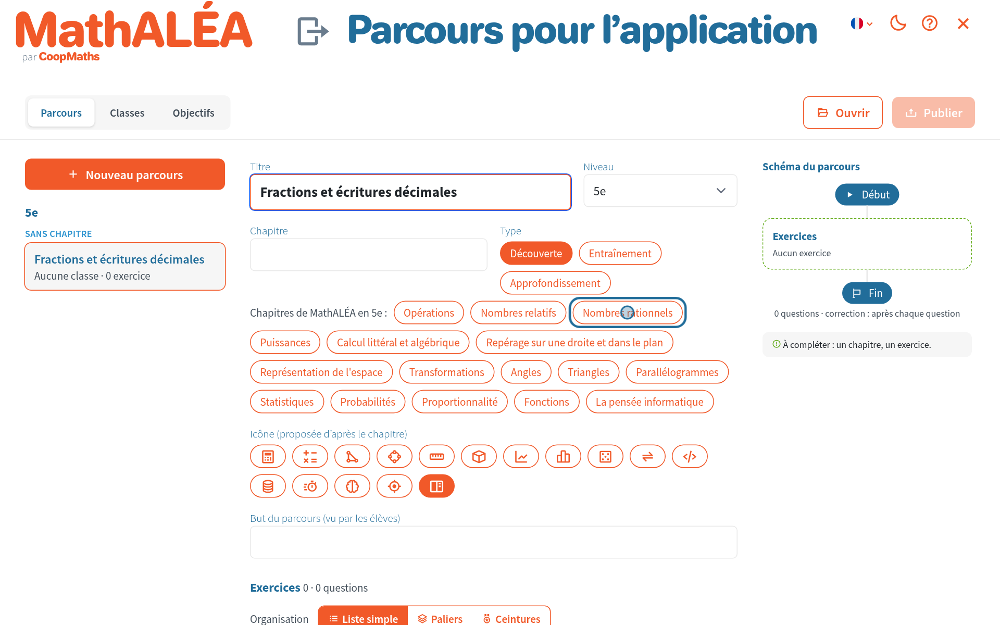

## 3. Ajouter des exercices

Écrivez le but du parcours (les élèves le voient) puis cliquez sur « Ajouter des exercices ».

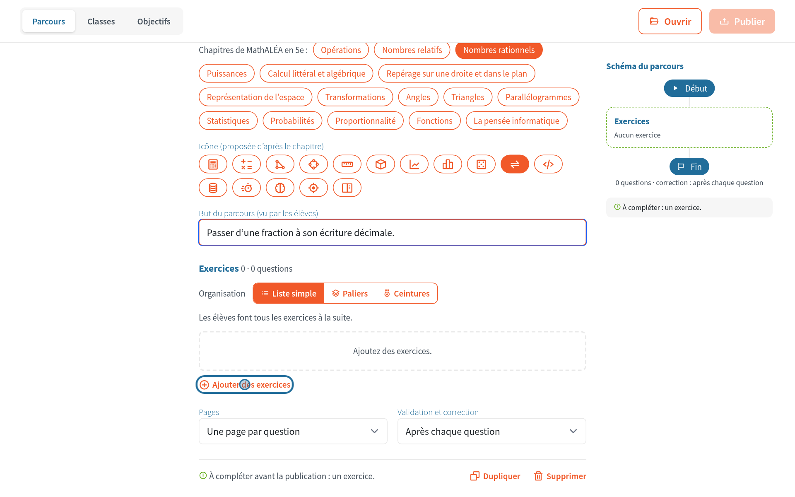

## 4. Le sélecteur de MathALÉA

C'est le sélecteur habituel du site. Il s'ouvre directement sur le chapitre choisi. Cliquez sur un objectif.

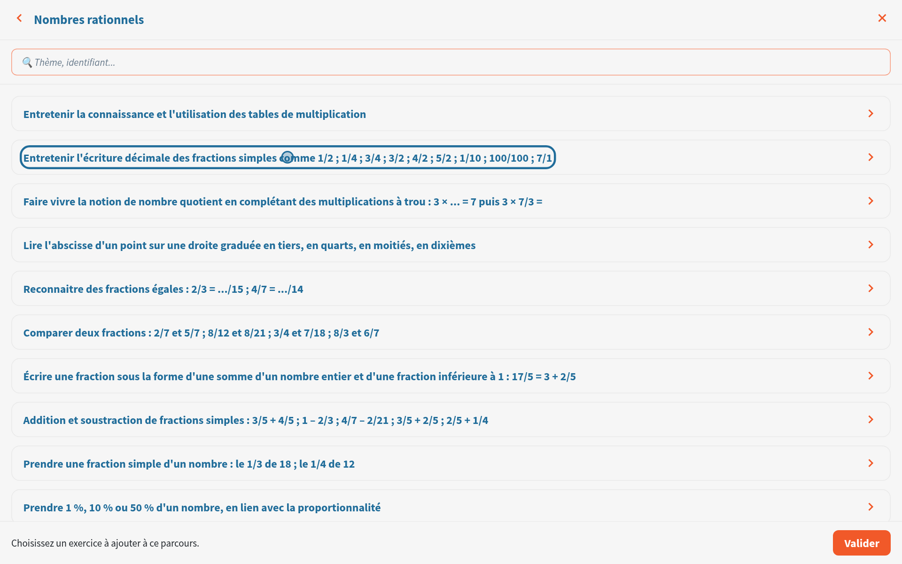

## 5. Régler et ajouter

Les paramètres de l'exercice sont ouverts avec un aperçu. Réglez-les puis cliquez sur « Ajouter ». Ajoutez autant d'exercices que vous voulez.

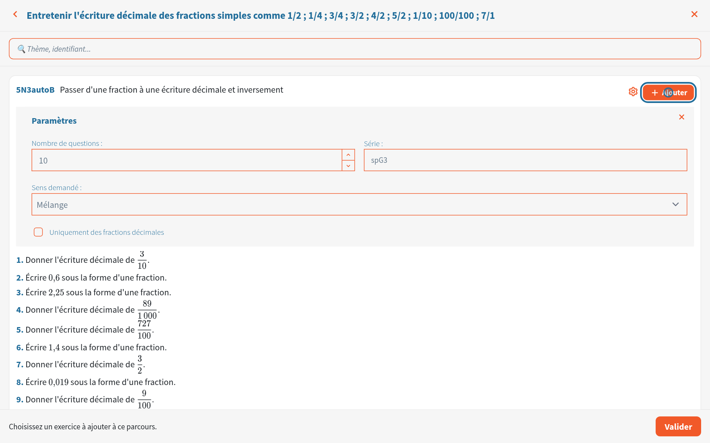

## 6. Valider

Cliquez sur « Valider » pour revenir au parcours.

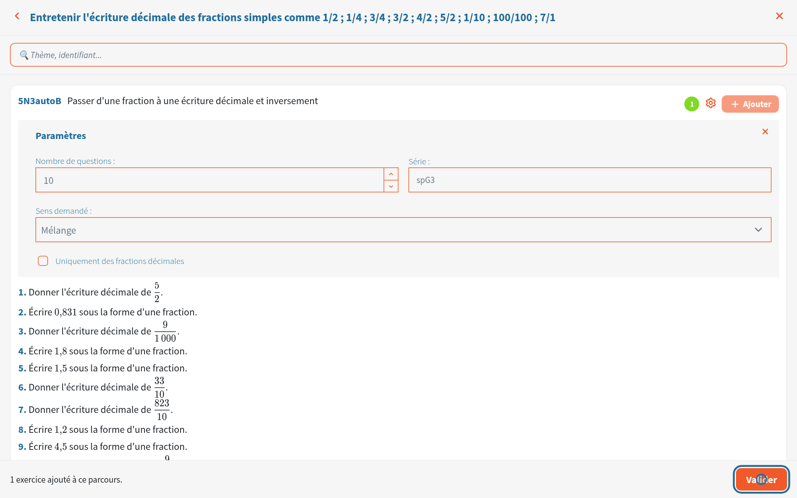

## 7. Le parcours

Le schéma à droite montre ce que verront les élèves. « Paliers » et « Ceintures » découpent le parcours en étapes. Quand le parcours est prêt passez à l'onglet « Classes ».

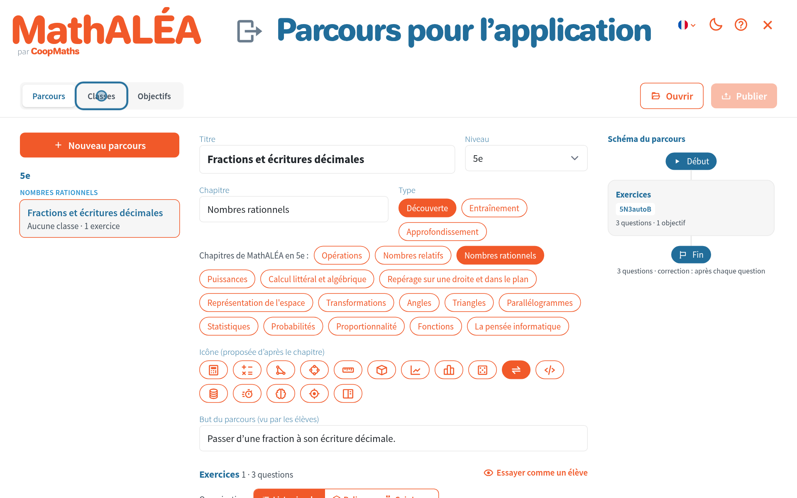

## 8. Une classe

Écrivez le nom de la classe tel que les élèves le verront puis cliquez sur « Classe ».

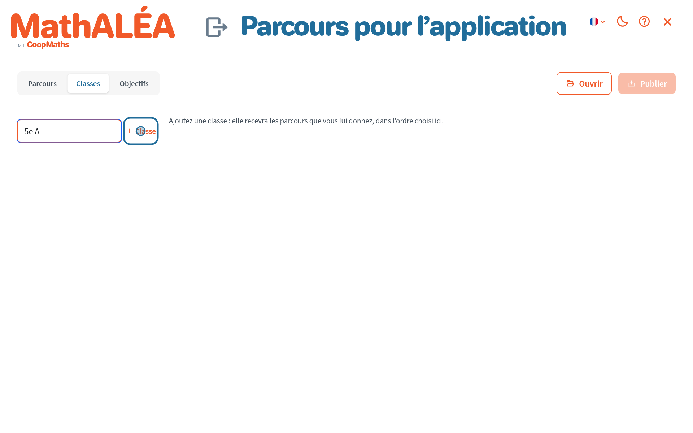

## 9. Ses parcours

Cliquez sur « Choisir les parcours de 5e A ».

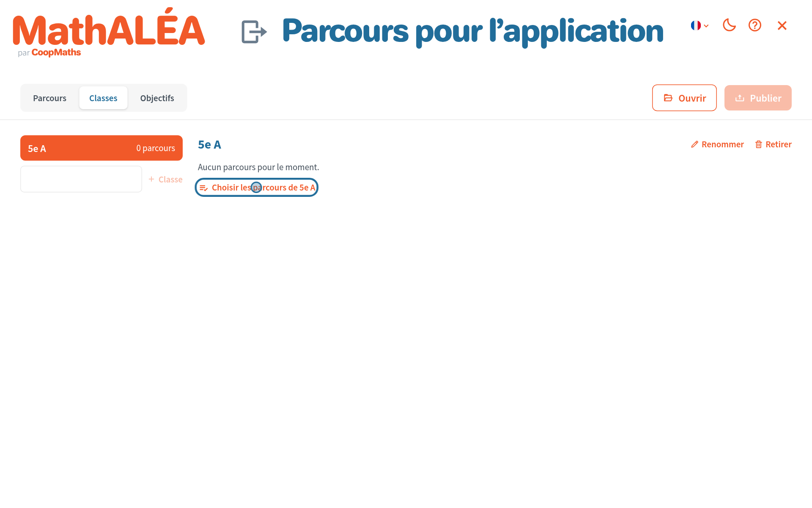

## 10. Publier

Cochez le parcours puis cliquez sur « Publier ».

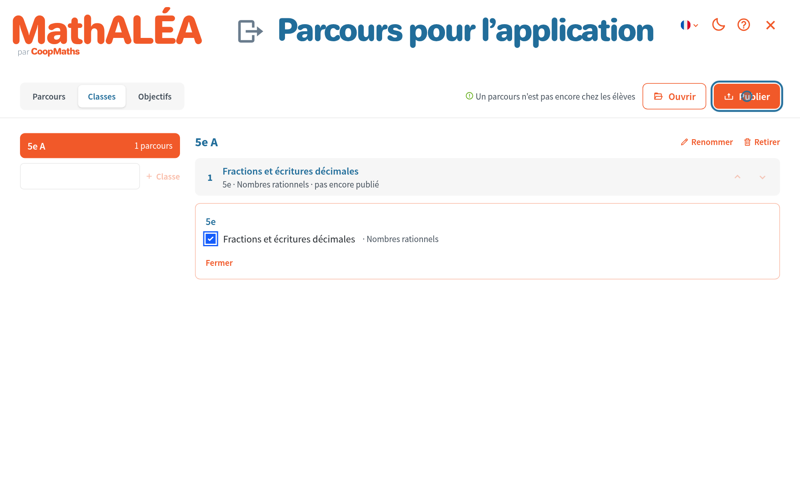

## 11. Déposer le fichier

Le fichier `parcours-mathalea-….json` est téléchargé. Déposez-le dans le dossier partagé de vos classes : les élèves le reçoivent au prochain lancement de leur application.

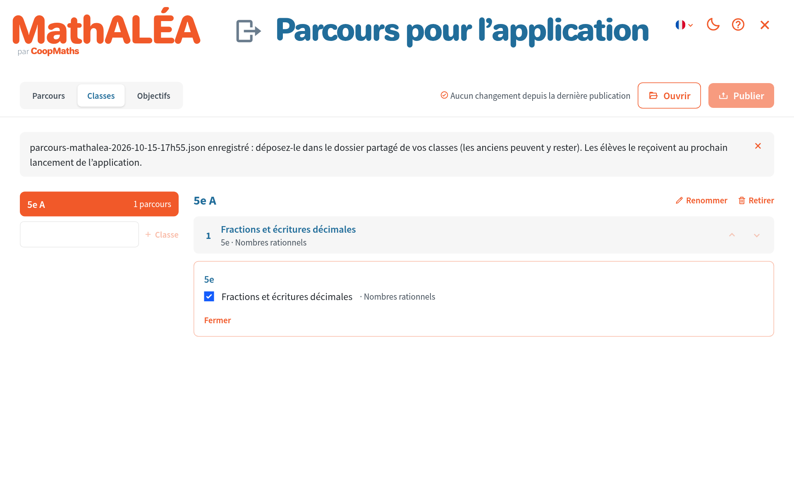

## Reprendre ce travail dans l'application

Le même fichier se reprend dans l'application du téléphone.

### 1. Reprendre ma bibliothèque publiée

Dans l'onglet Créer touchez « Reprendre ma bibliothèque publiée ».

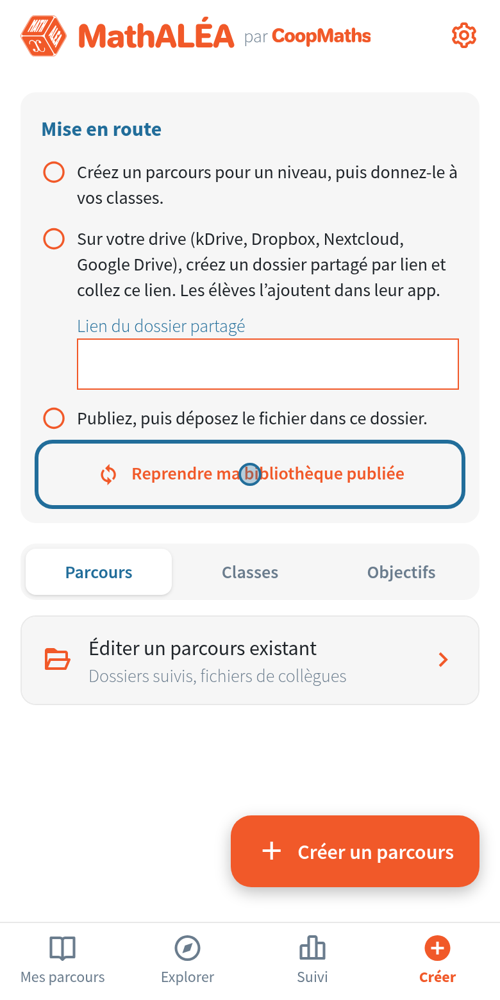

### 2. Le fichier ou le dossier

Collez le lien de votre dossier partagé, ou touchez « Choisir le fichier publié ».

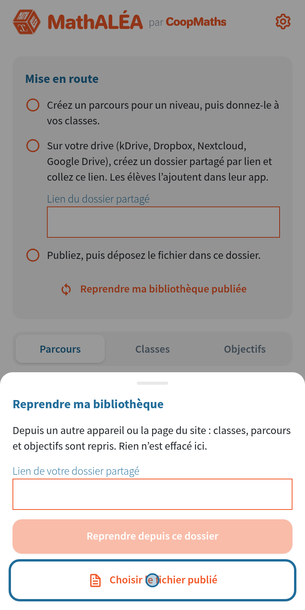

### 3. C'est repris

Les classes, les parcours et les objectifs sont repris. Rien n'est effacé sur le téléphone.

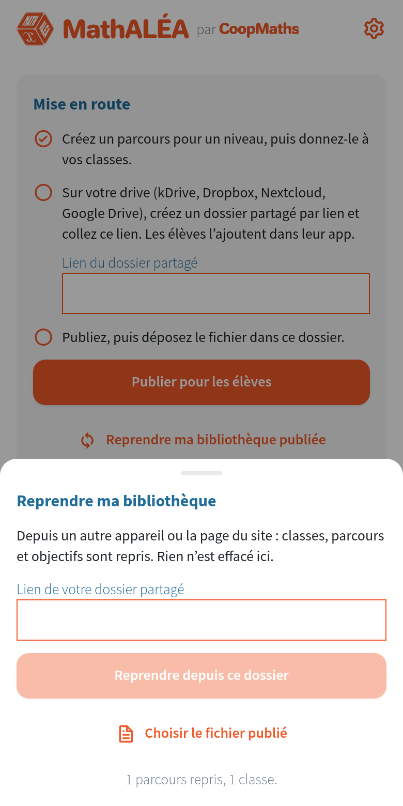

