# Créer un parcours sur le site MathALÉA

[Retour aux guides](index.md)

Les parcours de l'application se préparent sur le site MathALÉA, page « Parcours pour l'application ». On crée les parcours, on les donne aux classes et on publie un fichier, à déposer dans un dossier partagé de son drive.

Adresse de la page : [https://coopmaths.fr/alea/?v=parcours](https://coopmaths.fr/alea/?v=parcours). Elle sera sur le site dès sa prochaine mise en ligne.

## 1. Créer un parcours

Cliquez sur « Créer un parcours ». Si vous avez déjà publié un fichier, vous pouvez aussi le déposer ici pour reprendre votre bibliothèque.

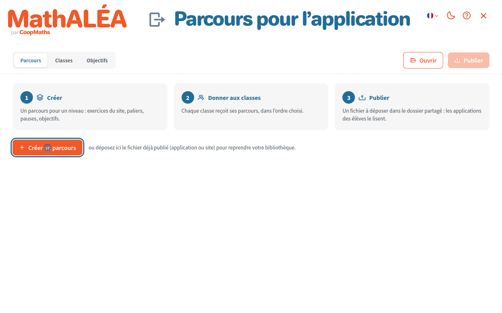

## 2. Titre, niveau et chapitre

Donnez un titre et choisissez le niveau. Les chapitres de MathALÉA du niveau sont proposés : cliquez sur le vôtre ou écrivez votre propre nom de chapitre.

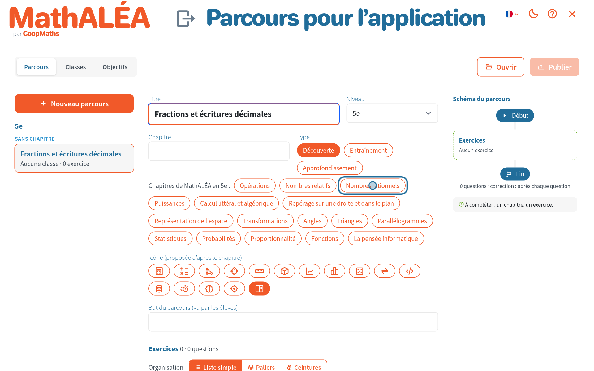

## 3. Ajouter des exercices

Écrivez le but du parcours, que les élèves verront, puis cliquez sur « Ajouter des exercices ».

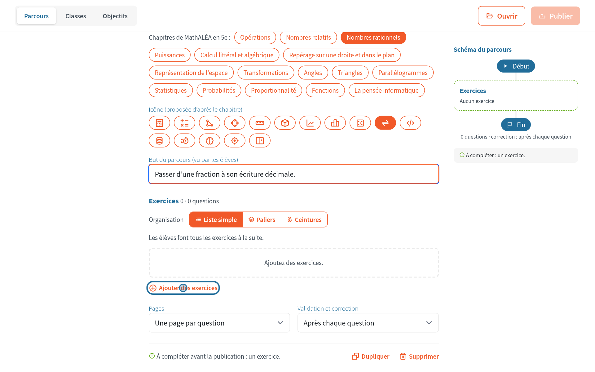

## 4. Le sélecteur de MathALÉA

C'est le sélecteur habituel du site. Il s'ouvre directement sur le chapitre choisi. Cliquez sur un objectif.

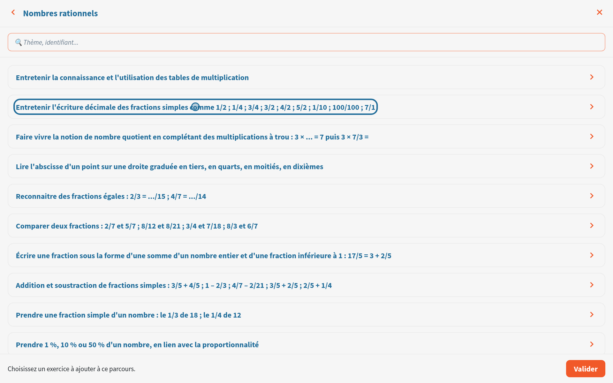

## 5. Régler et ajouter

Les paramètres de l'exercice sont ouverts avec un aperçu. Réglez-les puis cliquez sur « Ajouter ». Ajoutez autant d'exercices que vous voulez.

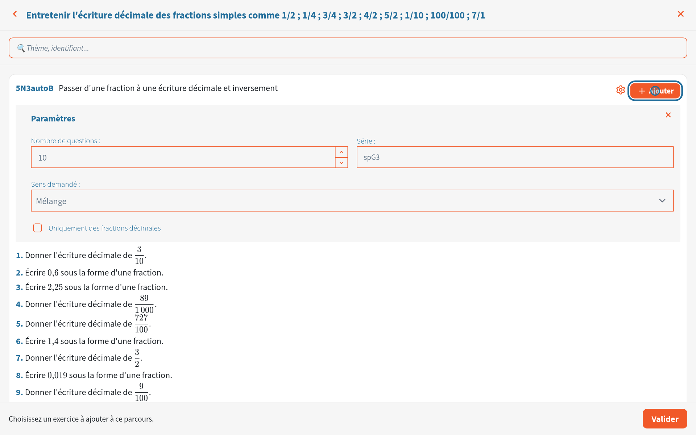

## 6. Valider

Cliquez sur « Valider » pour revenir au parcours.

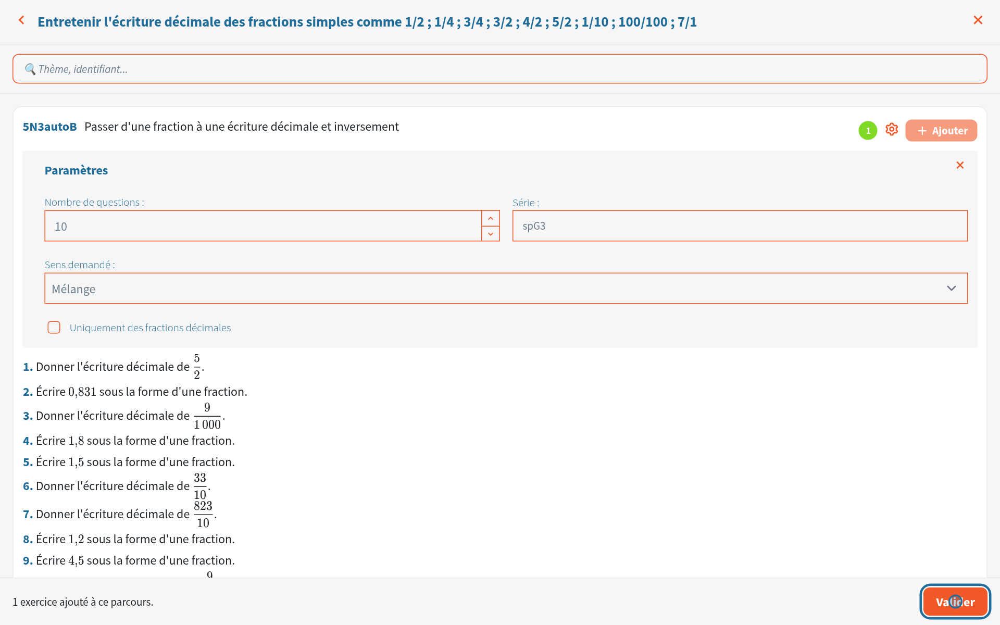

## 7. Le parcours

Le schéma à droite montre ce que verront les élèves. « Paliers » et « Ceintures » découpent le parcours en étapes. Quand le parcours est prêt, passez à l'onglet « Classes ».

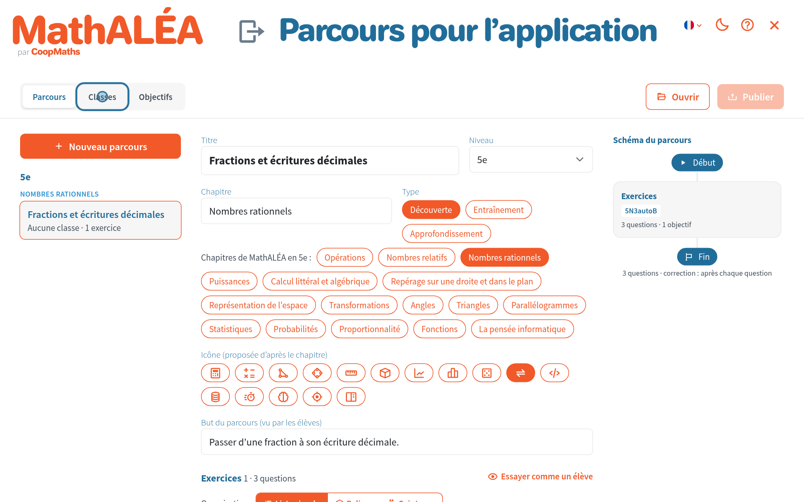

## 8. Une classe

Écrivez le nom de la classe, tel que les élèves le verront, puis cliquez sur « Classe ».

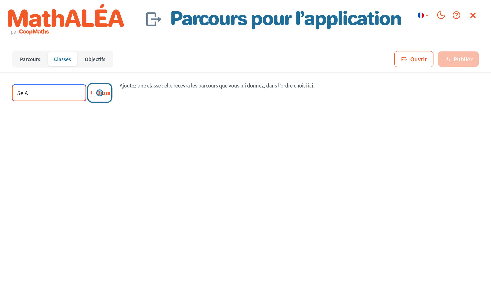

## 9. Ses parcours

Cliquez sur « Choisir les parcours de 5e A ».

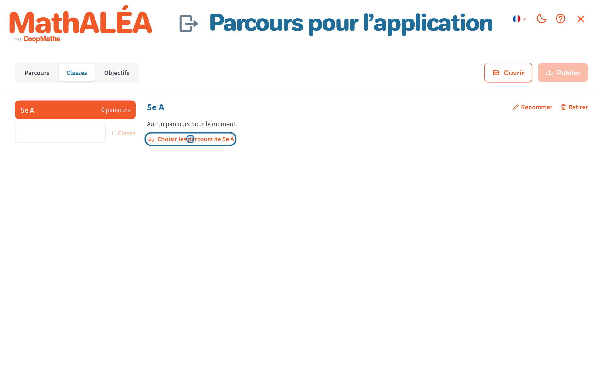

## 10. Publier

Cochez le parcours puis cliquez sur « Publier ».

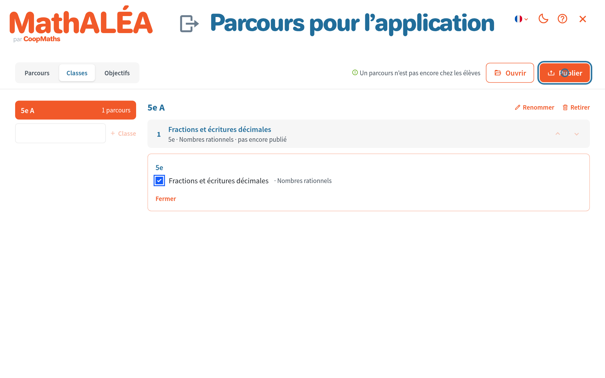

## 11. Déposer le fichier

Le fichier `parcours-mathalea-….json` est téléchargé. Déposez-le dans le dossier partagé de vos classes : les élèves le reçoivent au prochain lancement de leur application.

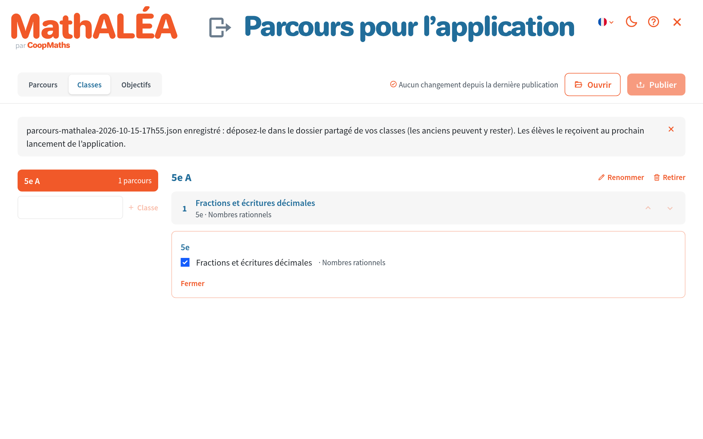

## 12. Le QR code de la classe

Le lien à donner aux élèves est celui du dossier partagé, suivi de `?classe=` et du nom de la classe : par exemple `https://kdrive.infomaniak.com/app/share/…/…?classe=5A`. Avec ce lien, l'élève arrive directement dans sa classe ; sans `?classe=`, il choisit sa classe parmi celles du fichier.

Faites un QR code de ce lien avec n'importe quel générateur (Chrome et Edge le proposent : ouvrez le lien, puis « Créer un code QR pour cette page »), et projetez-le ou affichez-le. Les élèves le scannent avec l'icône QR code en haut de leur accueil : le dossier est ajouté, leur classe choisie, sans rien saisir. Vous pouvez aussi donner le lien (sur l'ENT par exemple) : ils le collent une fois sur leur accueil.

## Une bibliothèque faite dans l'application

Jusqu'à la version 0.5, l'application avait un mode enseignant. Si vous y aviez préparé des parcours, ils sont toujours sur votre téléphone : Réglages, « Exporter ma bibliothèque », puis déposez ce fichier sur la page « Parcours pour l'application » pour continuer sur le site.
