# Créer un parcours dans l'application

[Retour aux guides](index.md)

Il faut d'abord activer « Je suis enseignant » dans les Réglages (voir [Découvrir](decouvrir.md), étape 3). Sur chaque image, le cercle bleu montre où toucher.

On crée un parcours pour un niveau, puis on le donne à une ou plusieurs classes. Enfin, on publie un fichier que l'on dépose dans un dossier partagé.

## Créer le parcours

### 1. Onglet Créer

Touchez « Créer un parcours ».

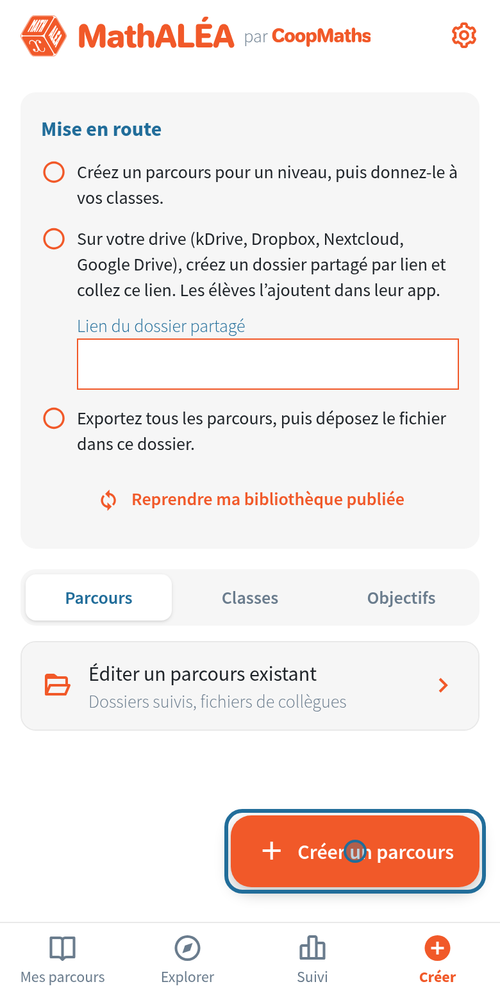

### 2. Le niveau

Touchez le niveau, ici 5e.

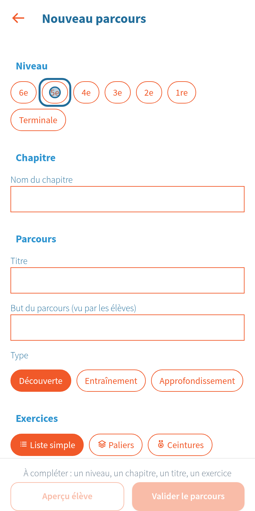

### 3. Chapitre, titre et but

Écrivez le nom du chapitre ; les chapitres que vous avez déjà utilisés sont proposés au-dessus. Donnez ensuite un titre et une phrase qui décrit le but du parcours : les élèves verront les deux.

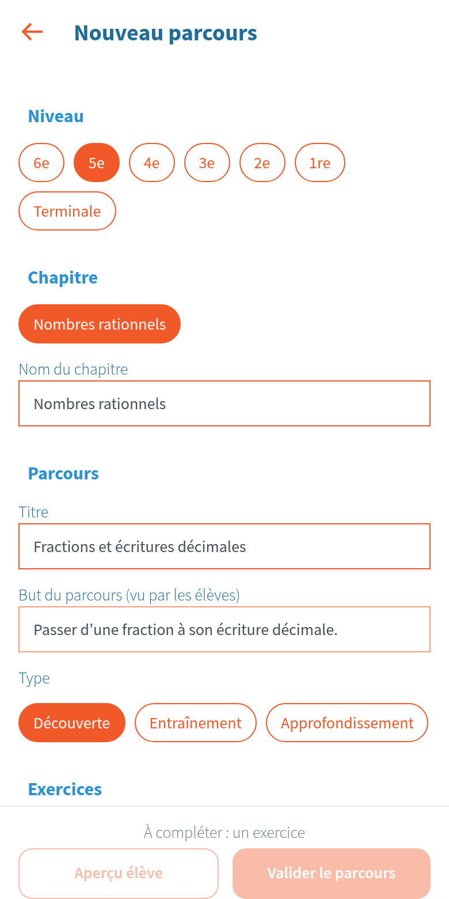

### 4. Ajouter des exercices

Plus bas, touchez « Ajouter des exercices ».

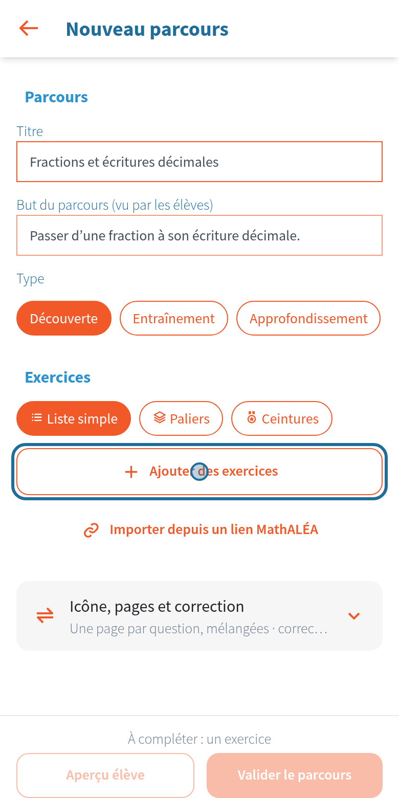

### 5. Le chapitre

Les chapitres du niveau s'affichent, comme sur le site. Touchez celui qui vous intéresse.

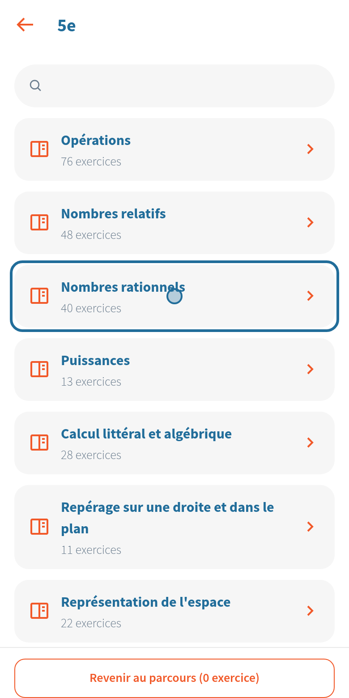

### 6. L'exercice

Touchez un exercice pour voir ses réglages et un aperçu.

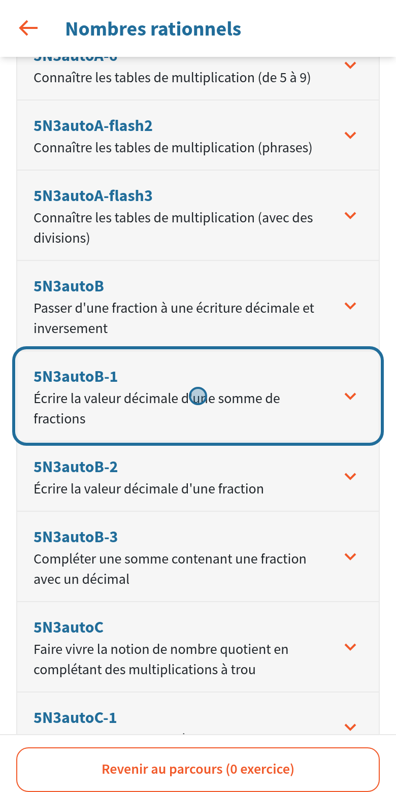

### 7. Régler, puis ajouter

Choisissez le nombre de questions et les options, comme sur le site, puis touchez « Ajouter au parcours ». Recommencez pour d'autres exercices.

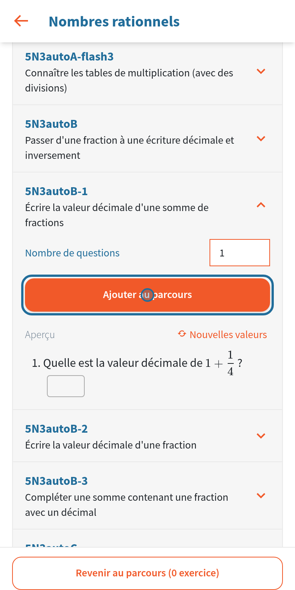

### 8. Revenir au parcours

Le bouton du bas indique le nombre d'exercices choisis. Touchez-le pour revenir au parcours.

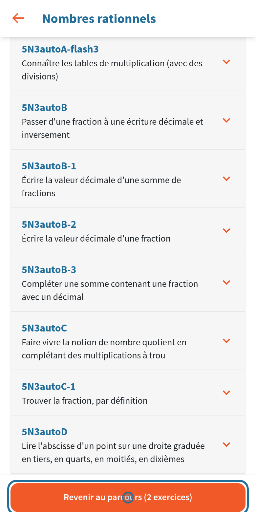

### 9. Valider

Les flèches changent l'ordre des exercices. « Paliers » et « Ceintures » découpent le parcours en étapes (voir la démonstration). Touchez « Valider le parcours ».

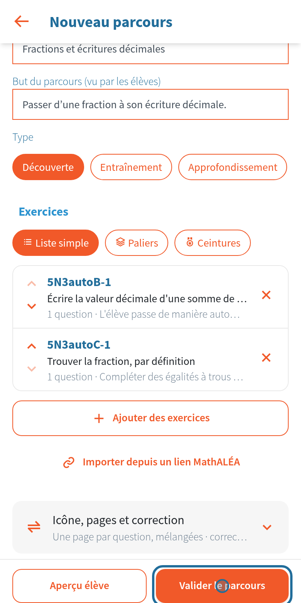

## Le donner à une classe

### 10. Donner à des classes

Le parcours est dans votre bibliothèque. Touchez « Donner à des classes ».

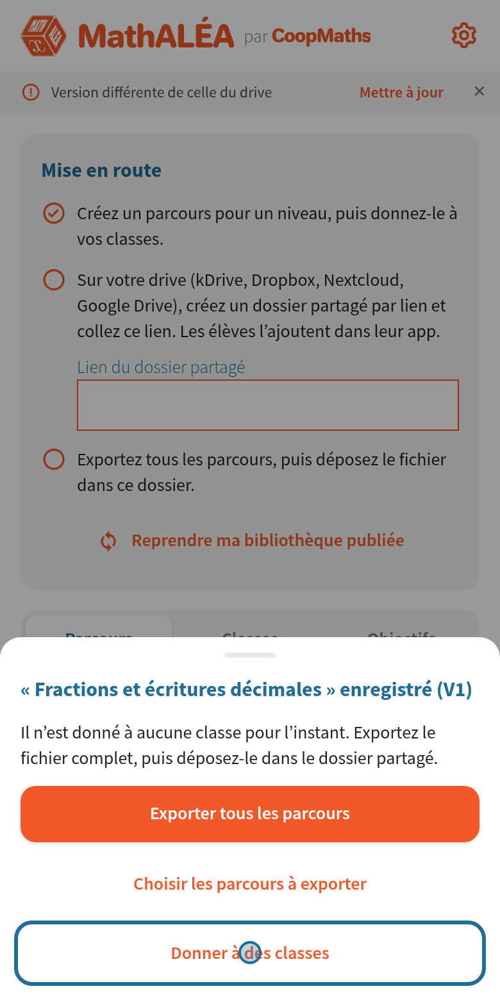

### 11. Créer la classe

Écrivez le nom de la classe, tel que les élèves le verront, puis touchez « Ajouter ».

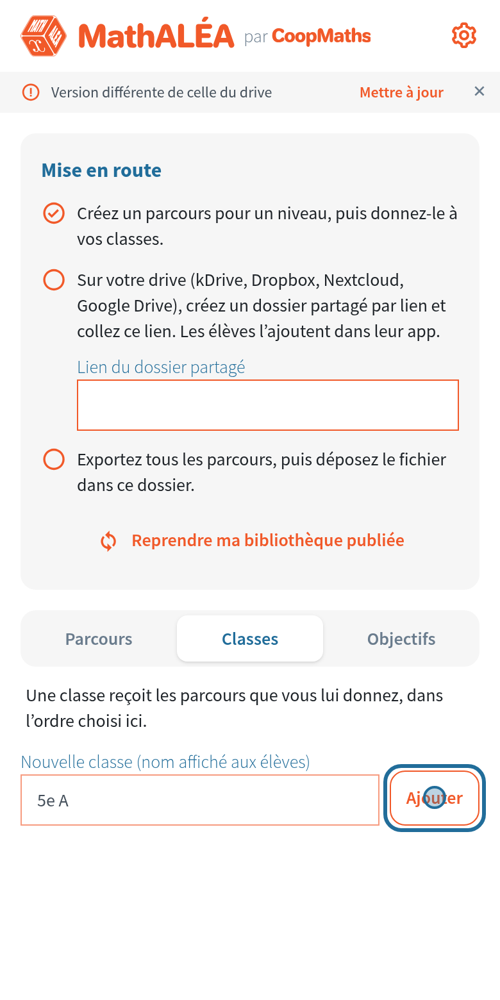

### 12. Choisir ses parcours

Touchez « Choisir les parcours de 5e A ».

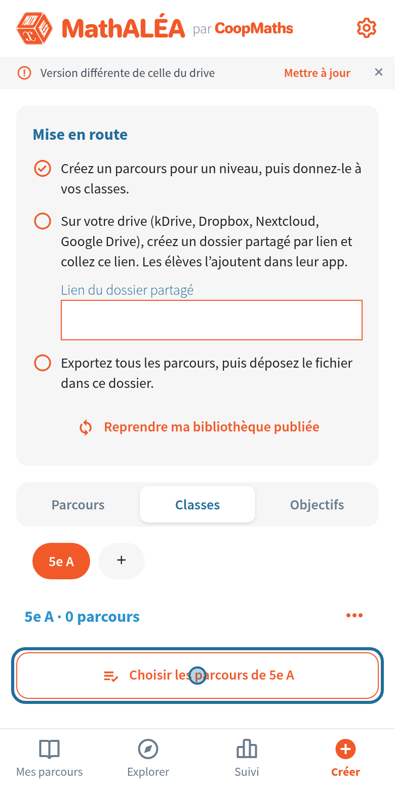

### 13. Cocher

Cochez le parcours, puis touchez « Enregistrer ».

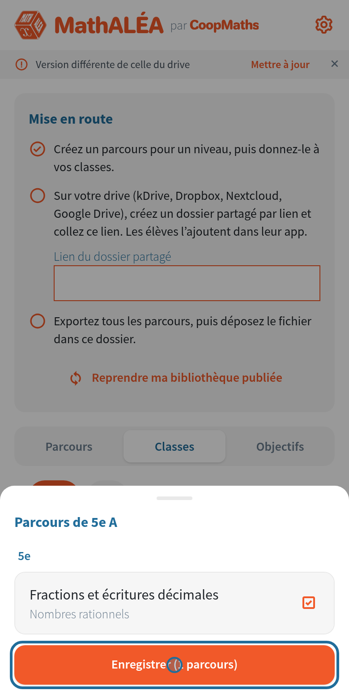

### 14. Retour aux parcours

La classe a maintenant son parcours. Touchez « Parcours » pour revenir.

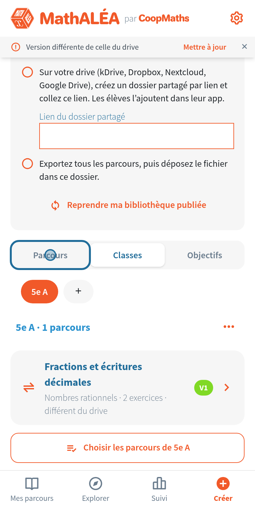

## Envoyer aux élèves

### 15. Le dossier partagé

Sur votre drive (kDrive, Dropbox, Nextcloud…), créez un dossier et partagez-le par lien, en lecture seule. Collez ce lien dans « Lien du dossier partagé », puis touchez « Enregistrer le lien ». C'est ce lien que vous donnerez aux élèves. Il ne change jamais.

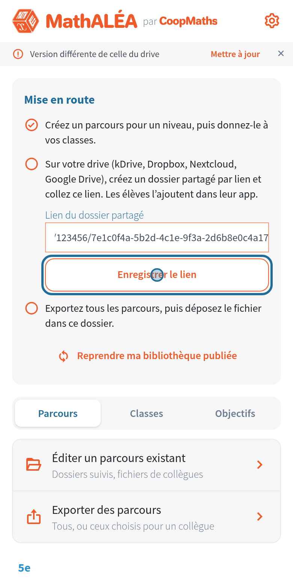

### 16. Exporter

Touchez « Mettre à jour » dans la bannière sous la barre (ou « Exporter tous les parcours » après l'enregistrement d'un parcours). Sur téléphone, choisissez l'application de votre drive puis le dossier partagé. Sur Android, « Enregistrer sur le téléphone » garde aussi le fichier dans un dossier de votre choix (Téléchargements, par exemple). Sur ordinateur, le fichier est enregistré : déposez-le ensuite dans le dossier partagé.

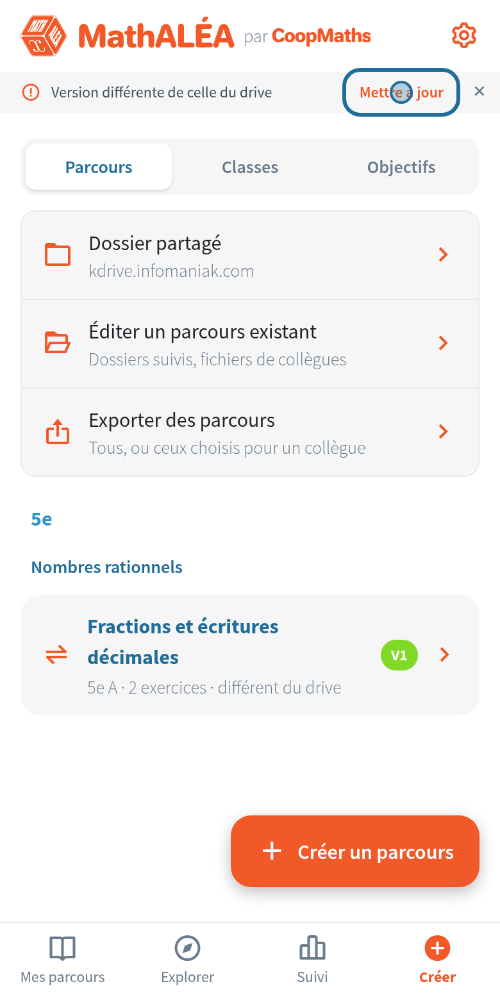

### 17. Vérifier

La bannière « Fichier exporté : déposez-le sur le drive » reste jusqu'à ce que l'app trouve le fichier dans le dossier. « Vérifier le dossier partagé » le contrôle tout de suite.

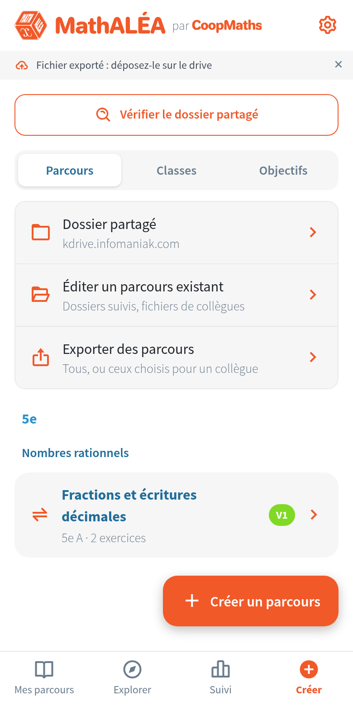

## Ensuite

- Un élève ne voit que les parcours donnés à sa classe.
- Pour modifier un parcours, en ajouter un ou en retirer un d'une classe, faites-le dans l'application : la bannière « Version différente de celle du drive » apparaît. Touchez « Mettre à jour » et déposez le nouveau fichier dans le dossier. Rien ne change chez les élèves avant ce dépôt. Les anciens fichiers peuvent rester dans le dossier : seul le plus récent compte.
- « Exporter des parcours » permet de décocher des parcours : le fichier ne contient alors que ceux choisis, pour un collègue par exemple. Déposé dans le dossier, il s'ajoute à la publication et y reste tant que vous ne le supprimez pas.
- Retirer un parcours n'efface rien chez l'élève. Ses résultats restent sur son appareil.
