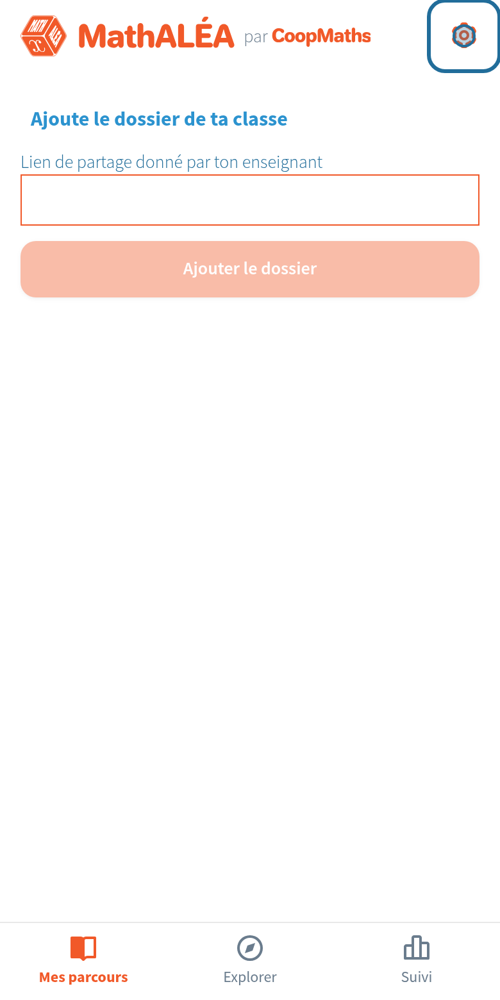
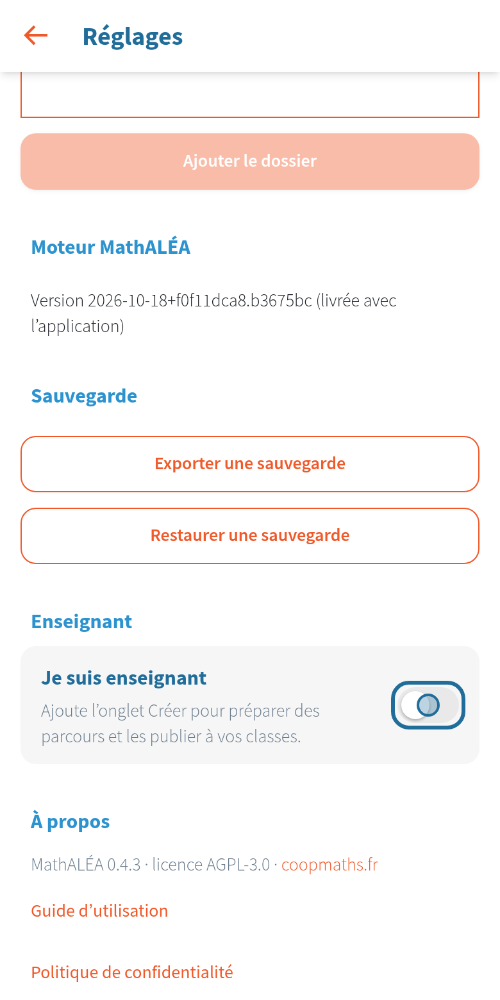
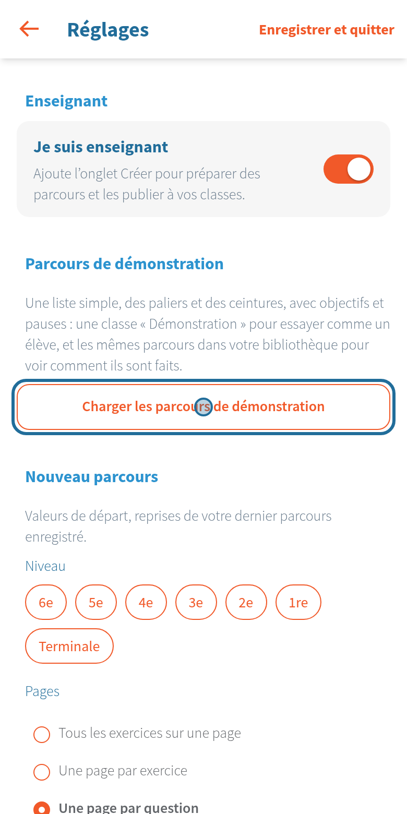
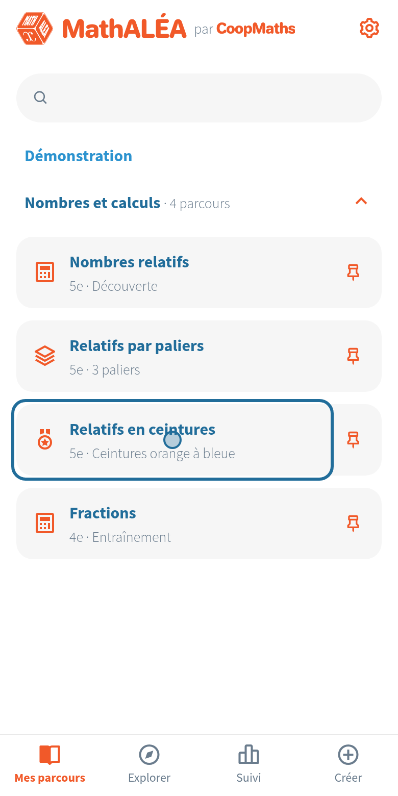
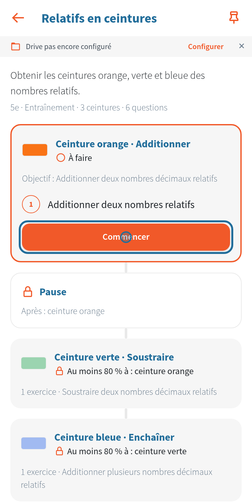
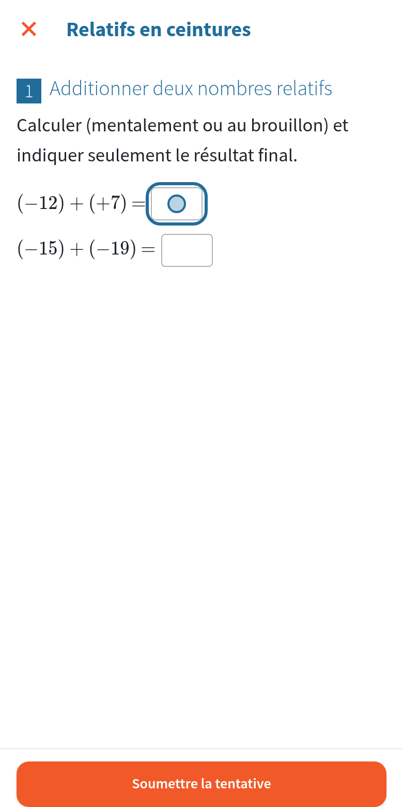
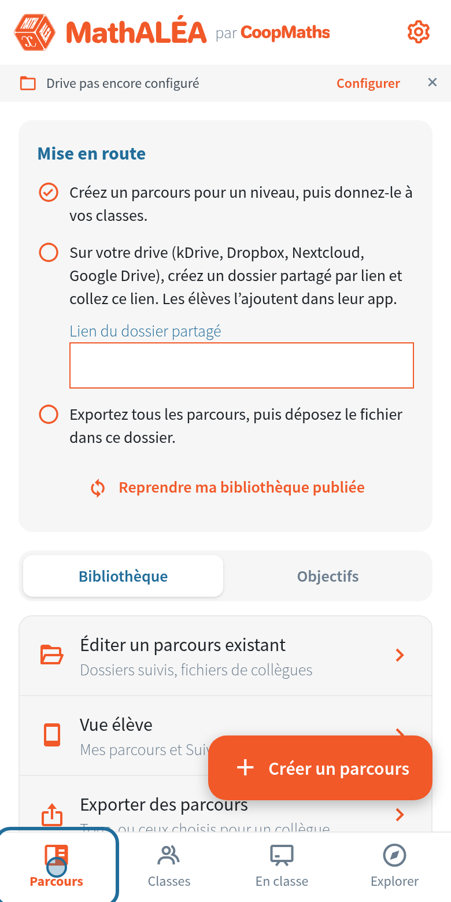
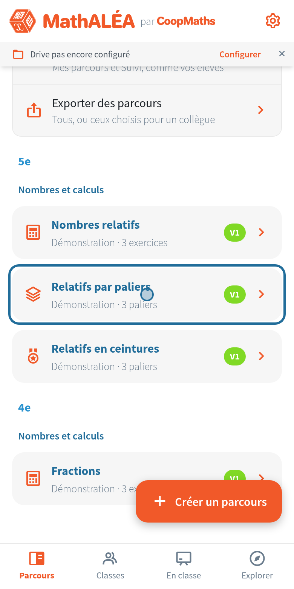
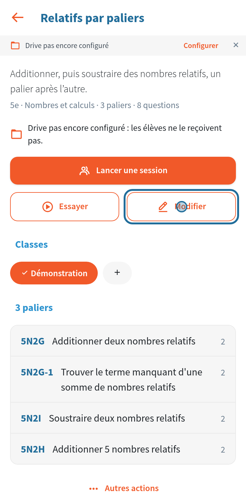
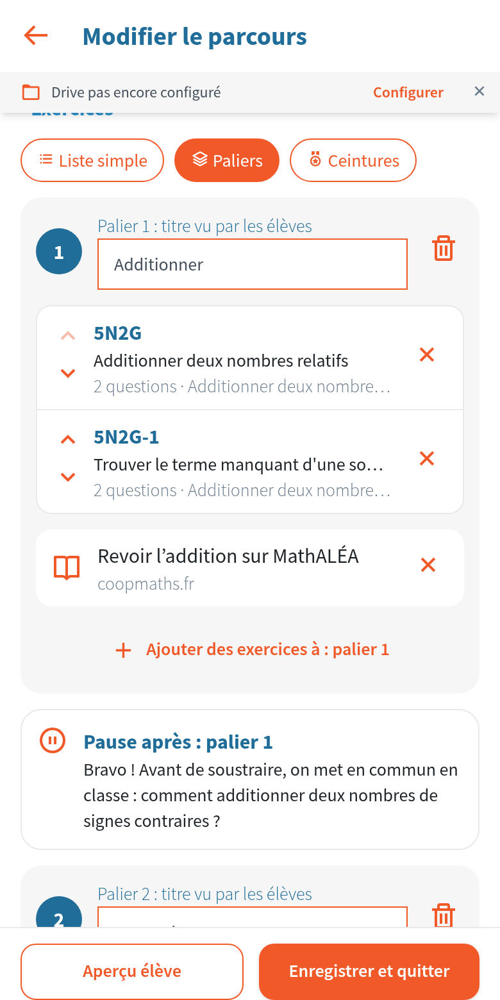

# Découvrir en cinq minutes

[Retour aux guides](index.md)

L'application contient des parcours de démonstration : une liste simple, des paliers et des ceintures. Vous les essayez comme un élève, puis vous regardez comment ils sont faits. Sur chaque image, le cercle bleu montre où toucher.

## 1. Le programme

Au premier lancement, choisissez France ou Suisse.

## 2. Les Réglages

L'accueil attend le dossier de votre classe. Pour l'instant, touchez la roue dentée en haut à droite.

## 3. « Je suis enseignant »

En bas des Réglages, activez « Je suis enseignant ». Les onglets Créer (vos parcours) et En classe (vos sessions) apparaissent.

## 4. La démonstration

Juste en dessous, touchez « Charger les parcours de démonstration ». Revenez ensuite avec la flèche en haut à gauche.

## 5. Un parcours, côté élève

Dans « Mes parcours », la classe Démonstration contient quatre parcours. Touchez « Relatifs en ceintures ».

## 6. La première ceinture

Une ceinture s'ouvre quand la précédente est réussie. Touchez « Commencer ».

## 7. Répondre

Touchez une case : le clavier de MathALÉA s'ouvre. Répondez, puis touchez « Soumettre ». La correction s'affiche aussitôt.

## 8. Comment c'est fait

Revenez à l'accueil et touchez l'onglet « Créer ».

## 9. La bibliothèque

Vous y retrouvez les mêmes parcours. Touchez « Relatifs par paliers ».

## 10. La page du parcours

Elle réunit tout ce qu'on fait avec un parcours : le donner à des classes, lancer une session en classe, l'essayer comme un élève. Touchez « Modifier ».

## 11. Les paliers

Chaque palier a son titre et ses exercices. On peut y ajouter une ressource pour revoir la notion, et une pause à la fin du palier (un mot pour les élèves, une mise en commun en classe…).

Pour enlever la démonstration, ouvrez les Réglages et touchez « Retirer les parcours de démonstration ».

Vous pouvez maintenant [créer votre premier parcours](creer.md).
