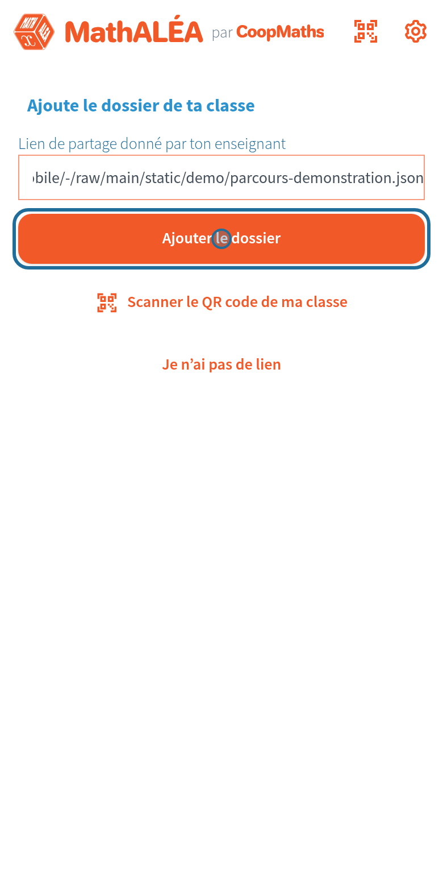
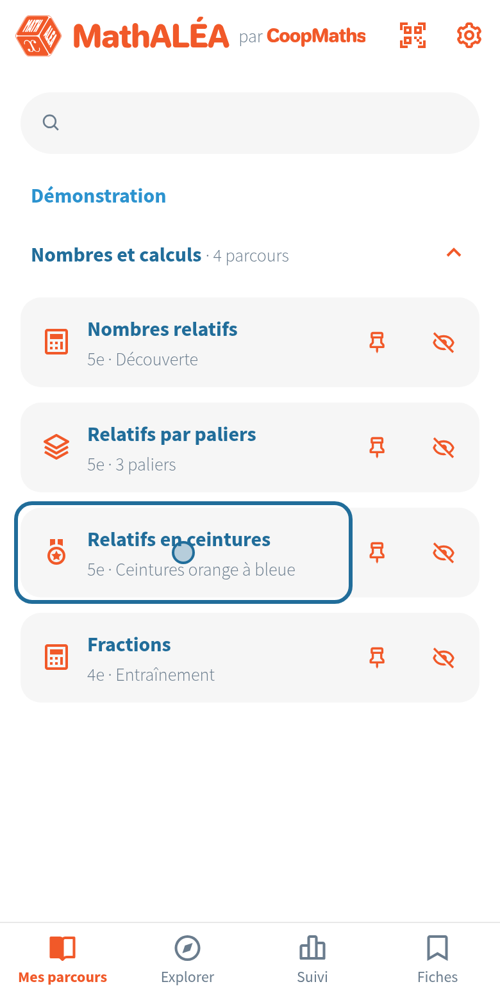
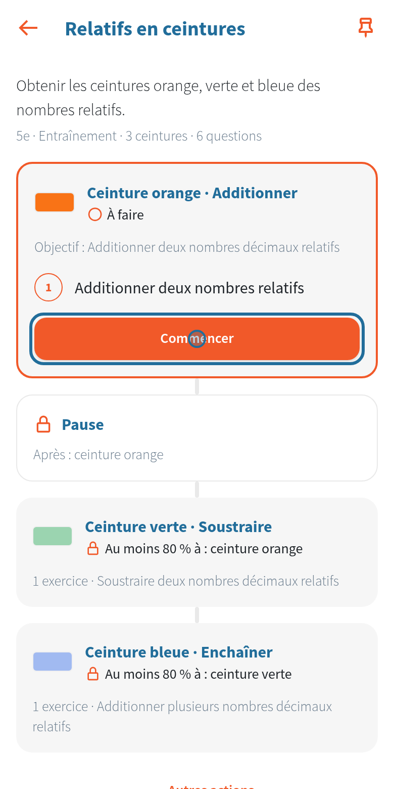
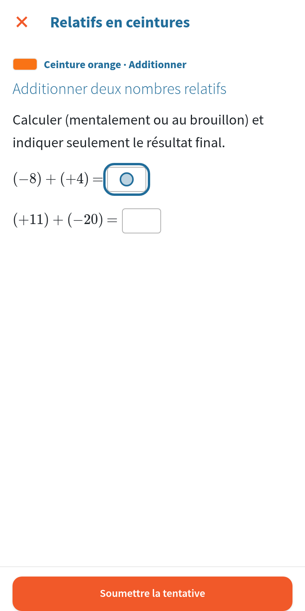

# Découvrir en cinq minutes

[Retour aux guides](index.md)

Un dossier de démonstration contient quatre parcours : une liste simple, des paliers, des ceintures et un entraînement. Vous l'ajoutez comme le ferait un élève avec le dossier de sa classe, puis vous faites un parcours. Sur chaque image, le cercle bleu montre où toucher.

## 1. Le programme

Au premier lancement, choisissez France ou Suisse.

## 2. Le lien du dossier

L'accueil attend le dossier de la classe. Touchez le champ « Lien de partage donné par ton enseignant ».

## 3. Le dossier de démonstration

Collez ce lien, puis touchez « Ajouter le dossier » :

`https://forge.apps.education.fr/coopmaths/mathalea-mobile/-/raw/main/static/demo/parcours-demonstration.json`

C'est exactement ce que fait un élève avec le lien de son enseignant (ou en scannant le QR code de sa classe, avec l'icône en haut de l'accueil).

## 4. Les parcours de la classe

La classe Démonstration contient quatre parcours, rangés par chapitre. Touchez « Relatifs en ceintures ».

## 5. La première ceinture

Une ceinture s'ouvre quand la précédente est réussie. Touchez « Commencer ».

## 6. Répondre

Touchez une case : le clavier de MathALÉA s'ouvre. Répondez, puis touchez « Soumettre ». La correction s'affiche aussitôt.

Pour retirer la démonstration : Réglages, « Dossiers partagés », la croix sur sa ligne.

Pour préparer vos propres parcours : [Créer un parcours sur le site MathALÉA](creer-sur-le-site.md).
