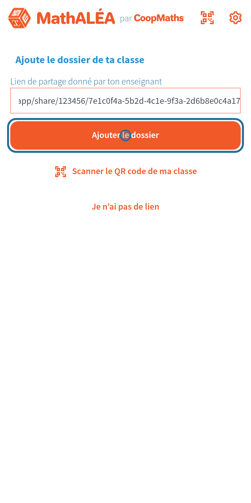
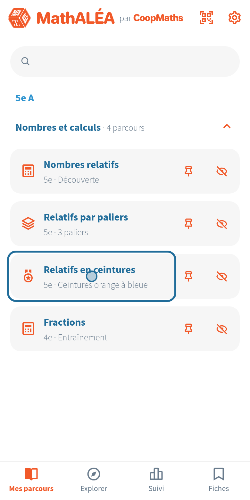
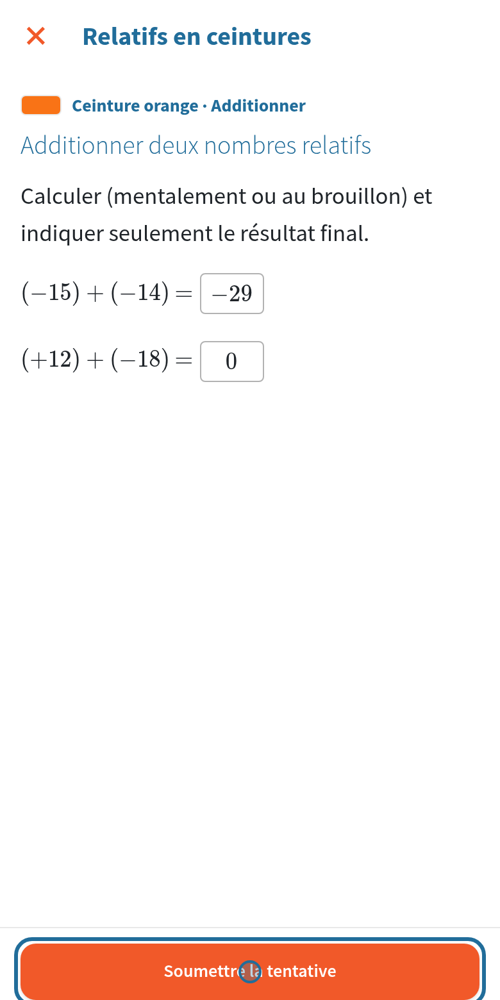
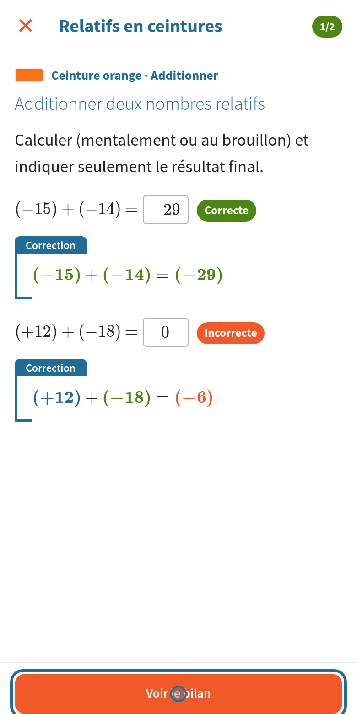
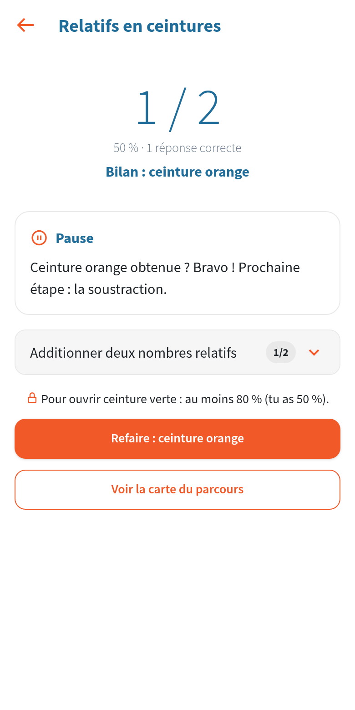
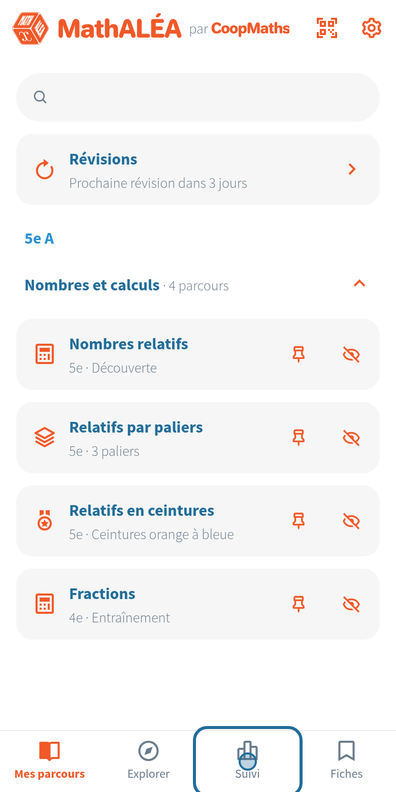
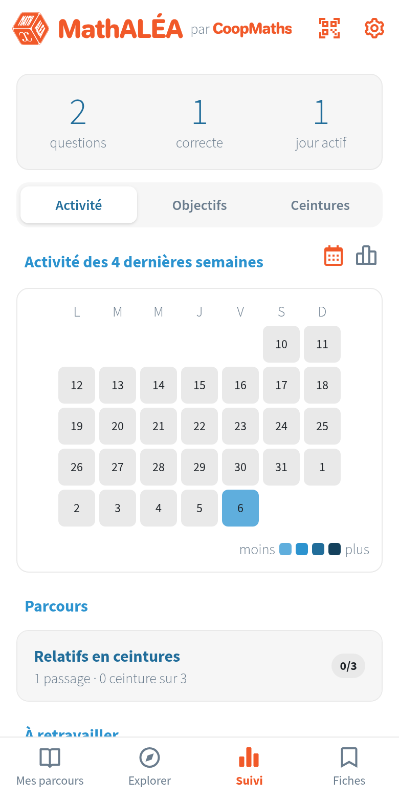

# Côté élève

[Retour aux guides](index.md)

Voici ce que fait un élève avec le lien donné par son enseignant. Sur chaque image, le cercle bleu montre où toucher.

## 1. Ajouter le dossier de la classe

Au premier lancement, l'élève choisit son programme, puis colle le lien donné par l'enseignant et touche « Ajouter le dossier ». Il ne le fait qu'une fois.

Si le dossier contient plusieurs classes, l'élève choisit la sienne. Un lien qui se termine par `?classe=3A` (ou `&CLASSE=3A`) choisit la classe d'office : c'est le lien que l'enseignant met dans le QR code de la classe ([Créer sur le site](creer-sur-le-site.md)).

Sans lien, l'élève touche « Je n'ai pas de lien » : l'accueil ne le lui demande plus, il travaille avec l'Explorer et ajoute le lien plus tard (« Ajouter le lien de ma classe », ou les Réglages).

Plus rapide : si l'enseignant projette le QR code de la classe, l'élève touche « Scanner le QR code de ma classe » (ou l'icône QR code en haut de l'accueil) et le vise. Le dossier est ajouté avec sa classe, sans lien à coller. Avec le QR code du dossier entier, l'élève choisit ensuite sa classe.

## 2. Ses parcours

Les parcours donnés à sa classe s'affichent, rangés par chapitre, avec ceux qu'il a ajoutés depuis l'Explorer (boussole à côté du titre). L'élève touche un parcours pour l'ouvrir. L'épingle d'une tuile la met en haut de la liste ; l'œil la cache (« Parcours cachés », en bas de l'accueil, la remet).

## 3. Répondre

Dans « Relatifs en ceintures », l'élève touche « Commencer », répond avec le clavier de MathALÉA, puis touche « Soumettre ». Les boutons restent en bas de l'écran ; le clavier s'ouvre juste au-dessus. S'il touche « Terminer » après avoir passé des questions, l'application les lui rappelle avant le bilan.

## 4. La correction

Chaque réponse est corrigée et la correction détaillée s'affiche. L'élève touche ensuite « Voir le bilan ».

## 5. Le bilan

Le bilan donne le score et la suite. Ici la ceinture orange n'est pas encore obtenue : il faut 80 % pour ouvrir la ceinture verte. L'élève peut refaire la ceinture, avec de nouvelles questions.

## 6. Les fiches de cours

L'onglet « Fiches » rassemble les fiches de cours de tous ses parcours, rangées par chapitre. Toucher un chapitre le replie ou le déplie ; dans un chapitre qui a plusieurs parcours, chaque parcours se déplie de même. La recherche trouve une fiche par le début d'un mot de son titre, de son parcours ou de son chapitre. Le signet d'une fiche l'enregistre dans « Mes fiches », en haut, dans l'ordre que l'élève choisit (flèches) ; une fiche enregistrée reste même si son parcours quitte l'appareil.

## 7. Le suivi

L'onglet « Suivi » rassemble son travail.

## 8. Ses progrès

L'élève y voit le nombre de questions faites, de réponses correctes et de jours de travail, puis le détail par parcours, par objectif et par ceinture. Les ceintures sont rangées par chapitre, seulement pour les parcours commencés : une ceinture obtenue prend sa couleur, les autres n'ont que leur contour. Tout reste sur son appareil.

## Bon à savoir

- Sans connexion, l'élève travaille quand même. Les nouveaux parcours arrivent à la prochaine connexion.
- Un parcours commencé se reprend là où il s'est arrêté.
- Pour changer de téléphone, l'élève touche « Exporter une sauvegarde » dans les Réglages et envoie le fichier sur le nouveau téléphone (AirDrop, message, drive). Au premier lancement du nouveau téléphone, « Récupérer mes données » reprend tout : dossiers, parcours terminés, séance en cours (à la question où elle s'était arrêtée), suivi.
- L'onglet Explorer propose aussi des parcours de l'équipe MathALÉA, rangés par degré selon le programme choisi (France ou Suisse) : la page d'un degré montre tous ses parcours sous le titre de leur chapitre. Le bouton « + » d'un parcours le met sur l'accueil, la coche l'en retire ; « Tout ajouter » met d'un coup le reste du degré. Un parcours commencé s'ajoute aussi à Mes parcours. Un parcours retiré garde ses ceintures : remis, il reprend là où il en était. La première ouverture de l'Explorer demande une connexion ; l'app garde ensuite sa copie hors ligne.
- Certains parcours ont des fiches de cours : formules, graphiques à manipuler, exemples pas à pas et petites questions qui ne comptent pas. La fiche s'ouvre la première fois avant l'entraînement, puis reste sur la page du parcours.
- En haut de l'Explorer (programme France seulement), « Teste ton niveau » : 15 questions de Course aux nombres ; avec 12 bonnes réponses, l'élève gagne la ceinture du niveau. On commence au niveau que l'on veut.

## Session partagée

L'enseignant ou un camarade affiche le QR code d'une session : touchez l'icône QR code en haut de l'accueil et visez-le, la session s'ouvre. Ou bien on vous donne un code : dans le parcours, « Autres actions », « Rejoindre une session », puis le code. Tout le monde a les mêmes questions. Chacun peut créer une session depuis la page d'un parcours. Voir [Sessions partagées](sessions.md).

## Signaler un problème

Un bug, une erreur dans un exercice, un contenu inapproprié : sur la page du parcours, « Autres actions », « Signaler un problème ». Un mail à l'équipe MathALÉA s'ouvre, avec le parcours déjà dedans. Le même panneau permet de cacher le parcours ; pour ne plus rien recevoir d'un dossier, retirez-le dans les Réglages.

## Révisions

Les exercices des parcours terminés reviennent au bon moment, avec de nouvelles valeurs : tuile « Révisions » en haut de « Mes parcours ». Voir [Révisions](revisions.md).
