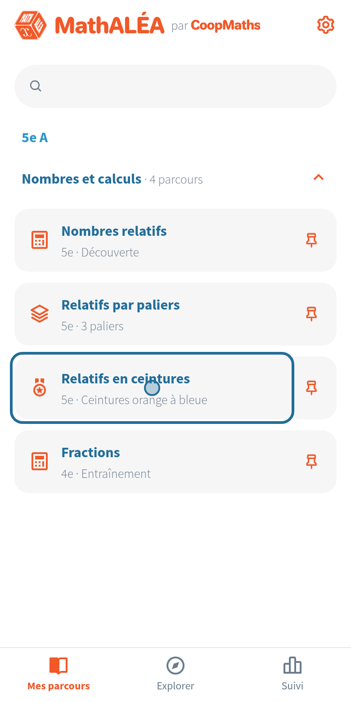
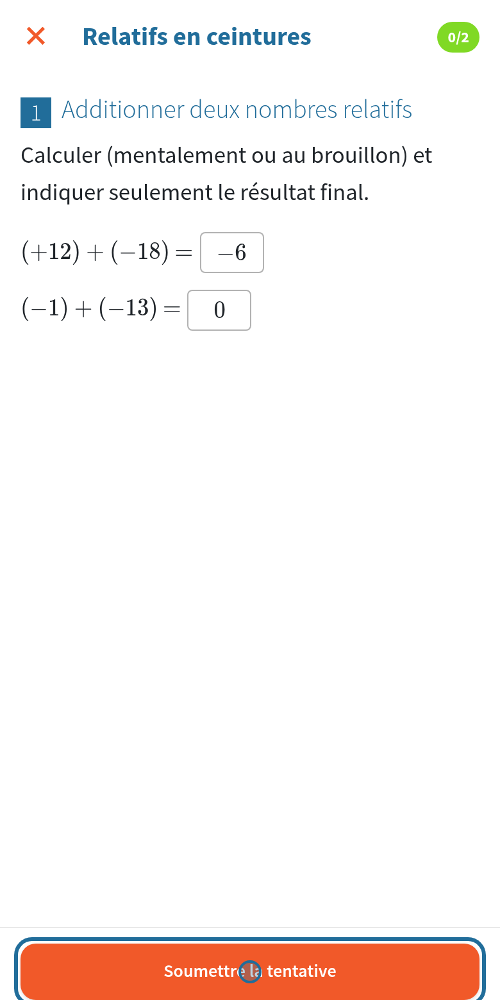
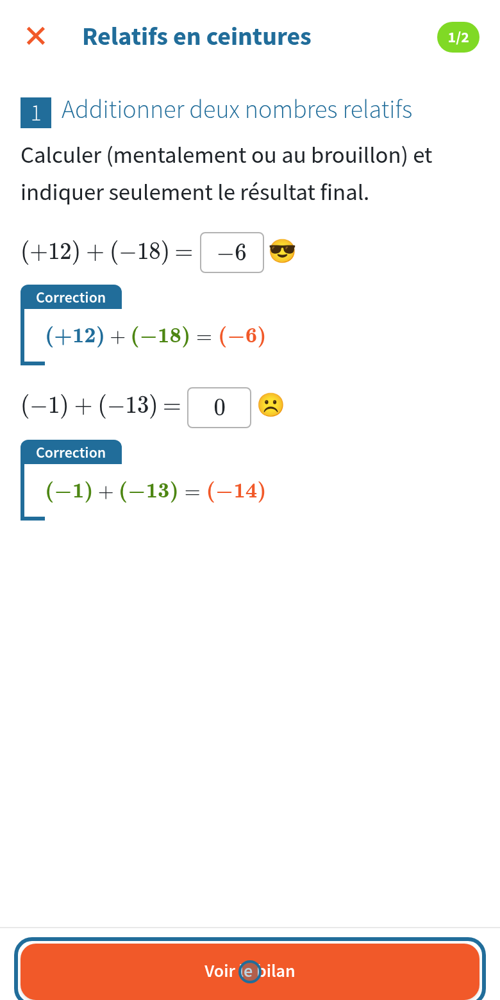
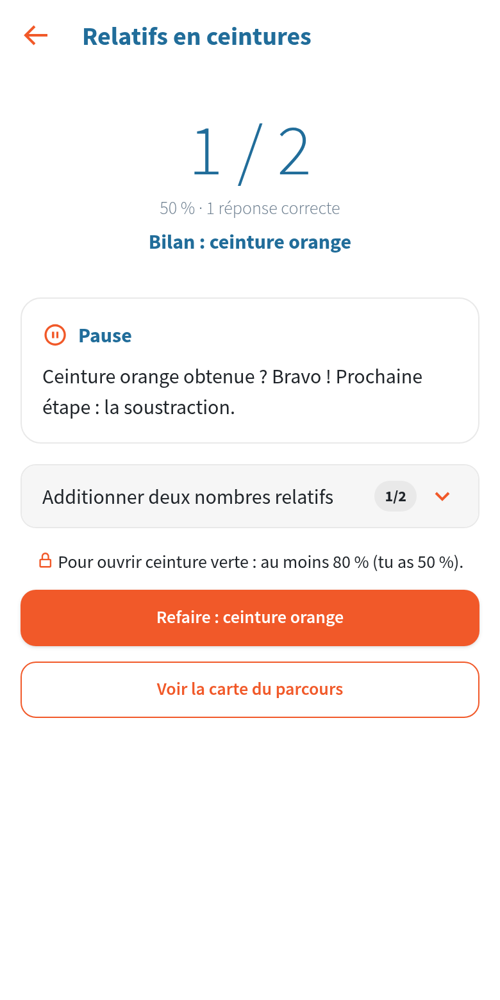
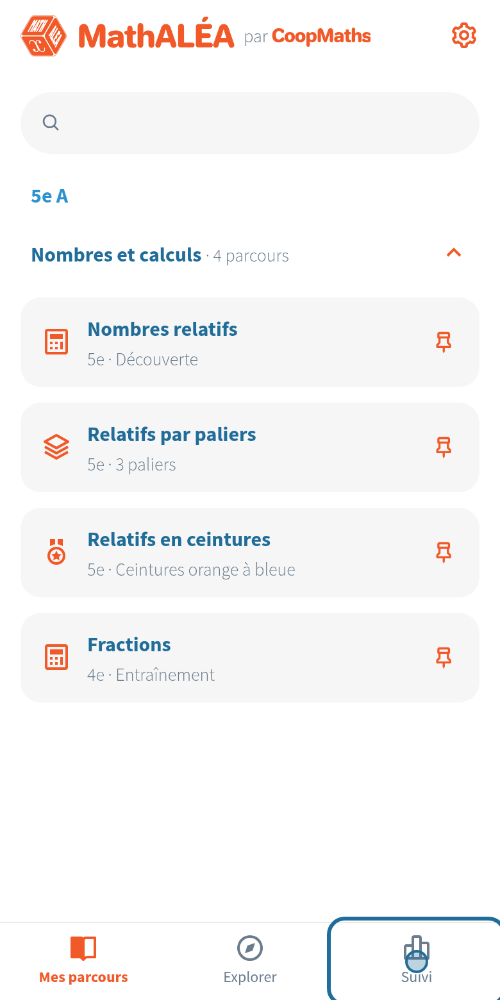
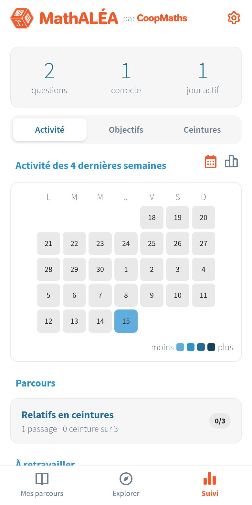

# Côté élève

[Retour aux guides](index.md)

Ce que fait un élève avec le lien donné par son enseignant. Sur chaque image, le cercle bleu montre où toucher.

## 1. Ajouter le dossier de la classe

Au premier lancement, l'élève choisit son programme, puis colle le lien donné par l'enseignant et touche « Ajouter le dossier ». Il ne le fait qu'une fois.

Si le dossier contient plusieurs classes, l'élève choisit la sienne.

## 2. Ses parcours

Les parcours donnés à sa classe s'affichent, rangés par chapitre. L'épingle garde un parcours en haut de la liste. Il touche un parcours pour l'ouvrir.

## 3. Répondre

Dans « Relatifs en ceintures », il touche « Commencer », répond avec le clavier de MathALÉA, puis touche « Soumettre ».

## 4. La correction

Chaque réponse est corrigée, avec la correction détaillée. Il touche « Voir le bilan ».

## 5. Le bilan

Le bilan donne le score et la suite. Ici la ceinture orange n'est pas encore obtenue : il faut 80 % pour ouvrir la ceinture verte. L'élève peut refaire la ceinture, avec de nouvelles questions.

## 6. Le suivi

L'onglet « Suivi » rassemble son travail.

## 7. Ses progrès

Questions faites, réponses correctes, jours de travail, puis le détail par parcours, par objectif et par ceinture. Tout reste sur son appareil.

## Bon à savoir

- Sans connexion, l'élève travaille quand même. Les nouveaux parcours arrivent à la prochaine connexion.
- Un parcours commencé se reprend là où il s'est arrêté.
- Pour changer de téléphone : Réglages, « Exporter une sauvegarde », puis « Restaurer une sauvegarde » sur le nouveau.
- L'onglet Explorer propose aussi des parcours de l'équipe MathALÉA, que l'élève peut ajouter lui-même.
