# Les réglages du parcours

[Retour aux guides](index.md)

Ce guide reprend un parcours créé comme dans [Créer un parcours et le publier avec le Nuage](parcours-nuage.md) et passe en revue ce que l'éditeur permet : paliers et ceintures, réglages de chaque exercice, ce que voient les élèves, objectifs, dossiers, classes et évaluations. Chaque réglage part aux élèves à la publication suivante.

## 1. Paliers et ceintures

Dans « Réglages du parcours », à gauche, choisissez « Par paliers » : le parcours se découpe en étapes, et chacune s'ouvre quand la précédente est réussie. « Ceintures » les présente comme les ceintures de couleur du judo ; « Première ceinture » permet de commencer plus loin que la blanche.

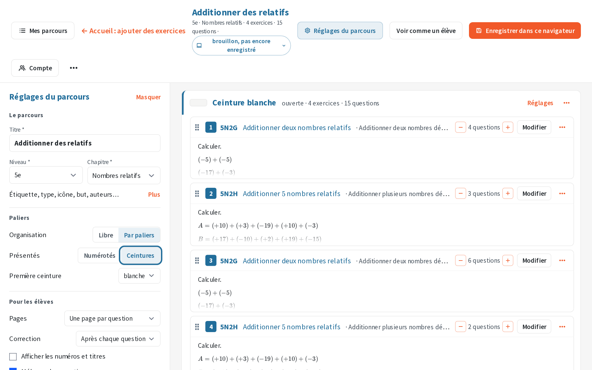

## 2. Découper et réorganiser

Le menu ⋯ d'un exercice permet de le monter ou de le descendre, de couper le palier après lui, de lier ses questions à celles de l'exercice suivant, de l'essayer comme un élève ou de le retirer. Un exercice se déplace aussi d'un palier à l'autre en le faisant glisser par sa poignée, à gauche.

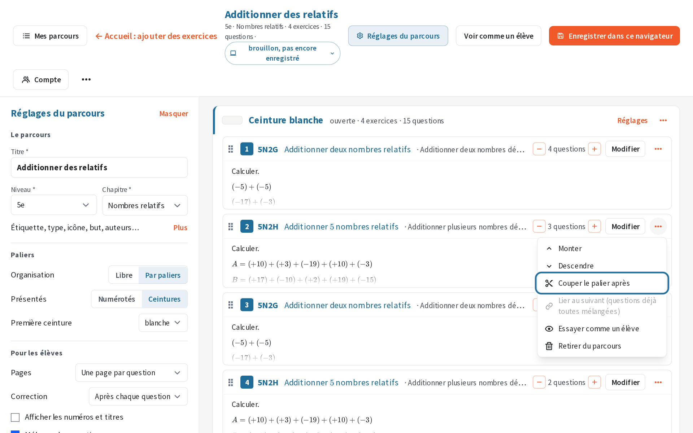

## 3. Réglages d'un palier

« Réglages », à droite du titre d'un palier, ouvre son titre vu par les élèves, la condition pour y accéder (un pourcentage au palier précédent, ou ouvert à tout moment), une date d'ouverture au format jj/mm/aaaa et l'ordre des questions. Avec une date, le palier s'ouvre ce jour-là à 8 h, même si le seuil est atteint avant.

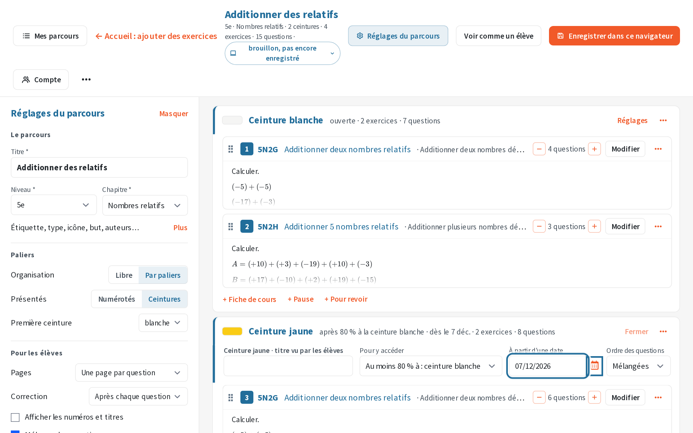

## 4. Régler un exercice

« Modifier » ouvre la fenêtre de l'exercice : l'aperçu tel que le verront les élèves, les paramètres de l'exercice comme sur l'accueil, et la partie « Dans le parcours ». On y change le titre vu par les élèves, on peut le masquer (« Exercice 1 » à la place), mélanger ses questions avec celles de l'exercice suivant et choisir ses objectifs. « Valider » enregistre, « Annuler » laisse l'exercice tel qu'il était.

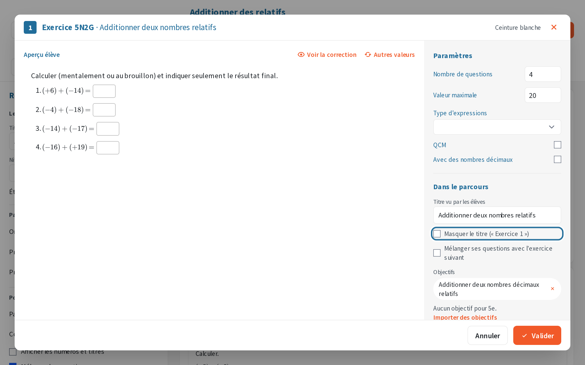

## 5. Fiche de cours, pause, pour revoir

Sous les exercices de chaque palier, « + Fiche de cours » ajoute une fiche de cours, que l'élève lit dans l'application avant de s'entraîner (on peut la montrer d'office avant la première séance). « + Pause » ajoute un texte affiché quand le palier est réussi, et « + Pour revoir » un lien vers une ressource pour revoir la notion.

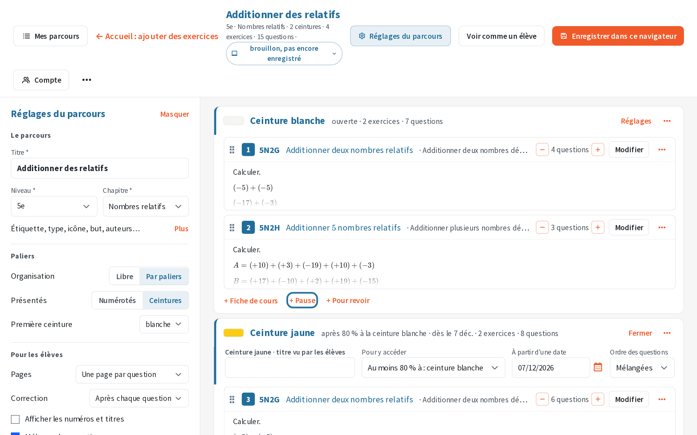

## 6. Ce que voient les élèves

La partie « Pour les élèves » règle l'affichage : la présentation des pages (une question ou un exercice par page), le moment de la correction (après chaque question, chaque page ou à la fin), les numéros et titres des exercices, le mélange des questions et la possibilité de réessayer une question manquée avec d'autres valeurs, hors score.

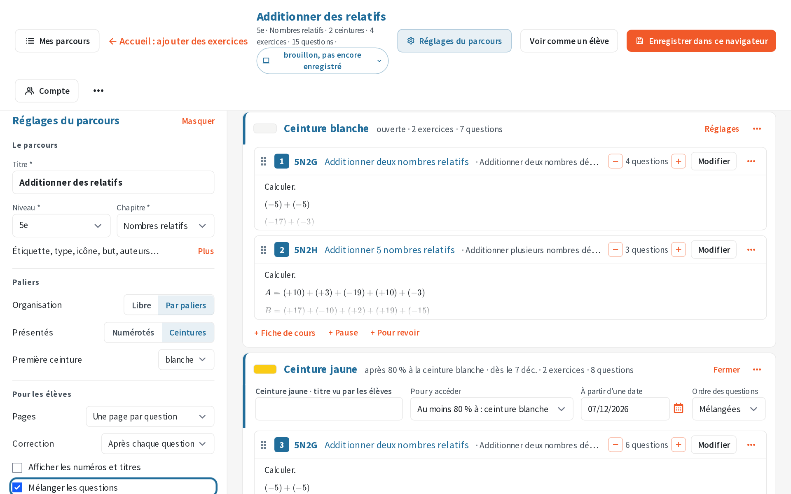

## 7. Les objectifs

La section « Objectifs », en bas des réglages, liste les objectifs de chaque exercice, rangés par palier. Un exercice reçoit d'office l'objectif du programme sous lequel MathALÉA le range ; la croix le retire. Avec une liste d'objectifs importée, un menu permet d'en ajouter. Les élèves retrouvent ces objectifs dans leur suivi.

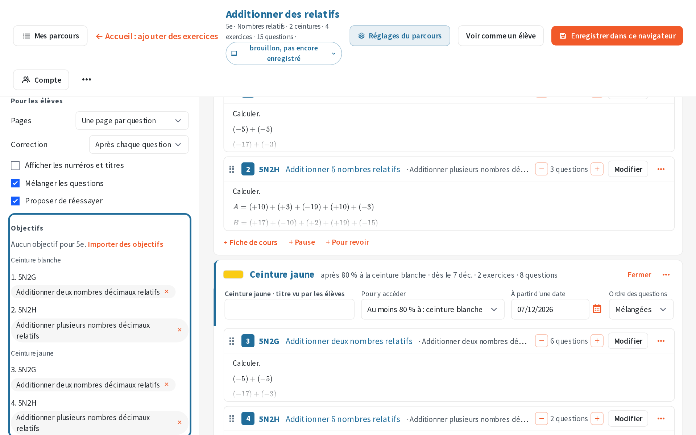

## 8. Importer une liste d'objectifs

La rubrique « Objectifs » de Mes sauvegardes importe vos objectifs, par un fichier (CSV, texte) ou par une liste collée, avec leur niveau et leur chapitre. Ils deviennent ensuite proposés dans les exercices du même niveau.

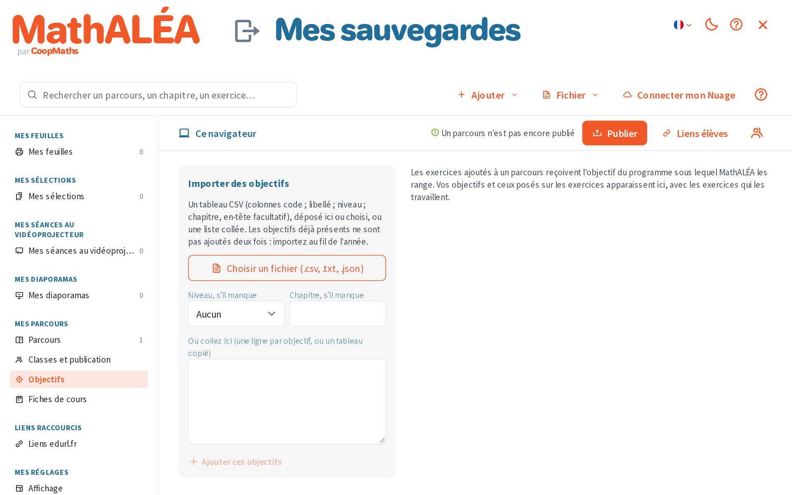

## 9. Voir comme un élève

« Voir comme un élève » montre la page du parcours dans l'application : ceintures, conditions et dates d'ouverture. « Revenir à la construction » ramène à l'éditeur.

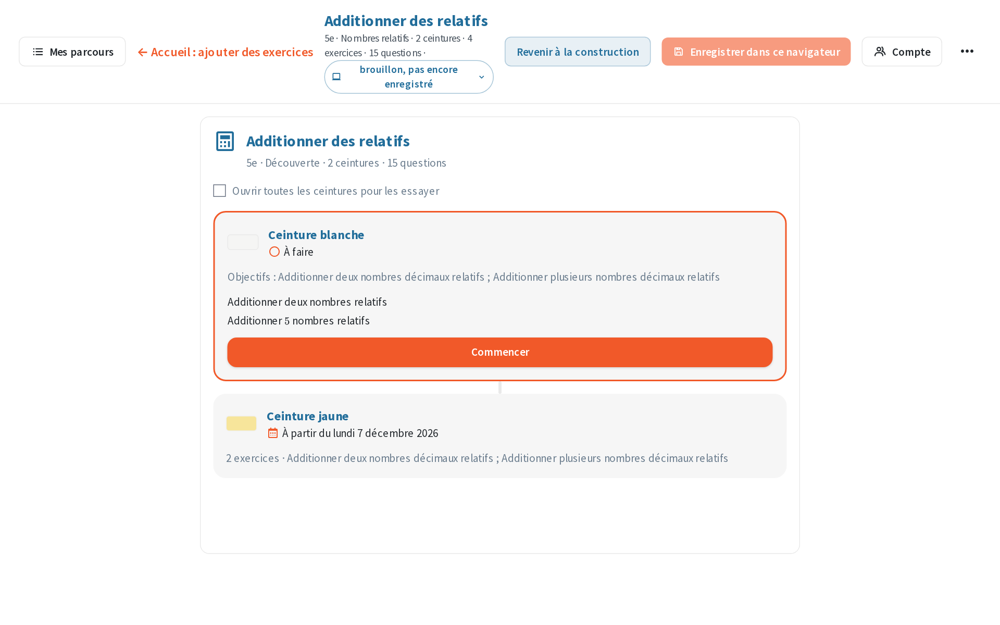

## 10. Tester le parcours

Le menu ⋯ du parcours propose « Tester le parcours » : tous les paliers sont ouverts, on avance sans répondre et on voit la correction de chaque question. On y trouve aussi les liens des classes, « Dupliquer le parcours » et « Supprimer le parcours ».

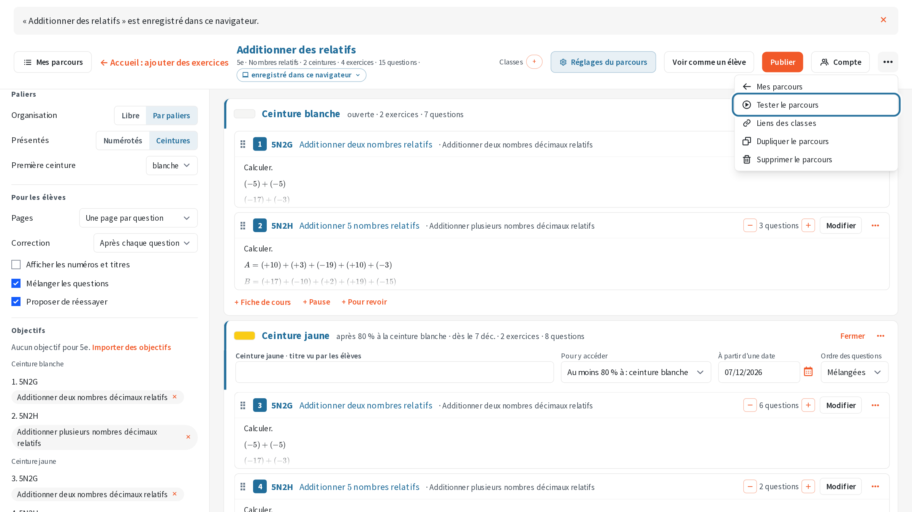

## 11. Ajouter des exercices depuis l'accueil

« Accueil : ajouter des exercices » renvoie à la page d'accueil avec les exercices du parcours. Ajoutez-en, retirez-en ou changez leurs réglages, puis cliquez sur « Retour au parcours » : un exercice ajouté va dans le palier de celui qui le précède, et le reste de l'organisation est gardé.

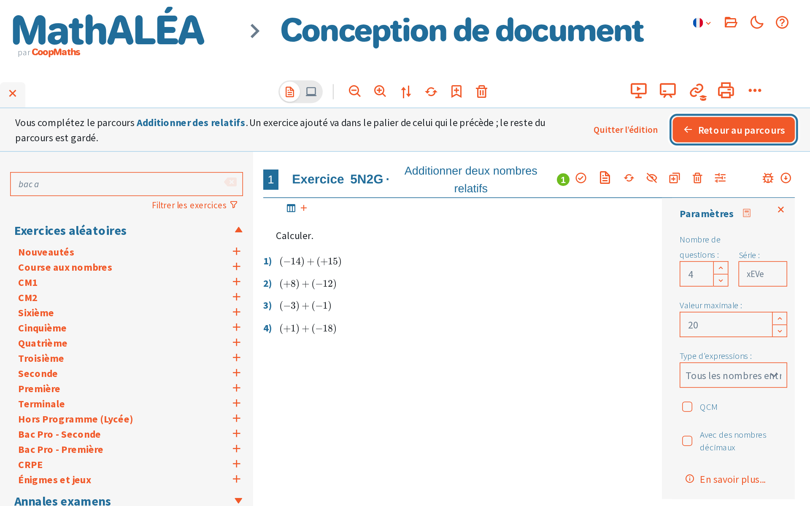

## 12. Ranger les parcours dans des dossiers

Dans la liste des parcours, « Créer un dossier » ajoute un dossier, et l'icône « Ranger dans un dossier » d'un parcours l'y place. Ces dossiers servent à votre classement : les élèves ne les voient pas.

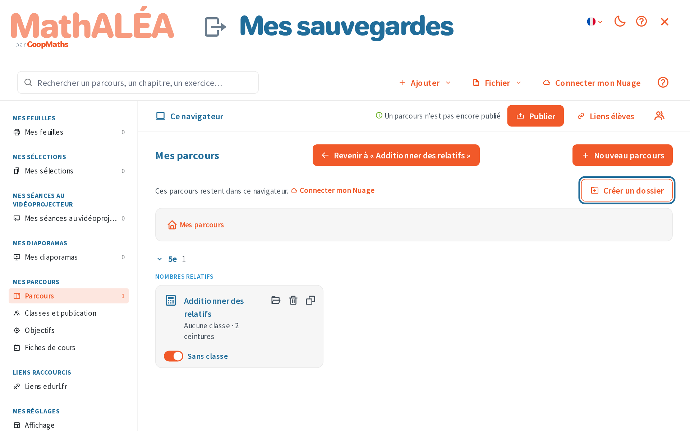

## 13. Gérer une classe

Dans « Classes et publication », chaque classe a sa liste de parcours. Les flèches changent l'ordre dans lequel les élèves les voient, la croix retire un parcours de la classe, « Renommer » et « Retirer » s'appliquent à la classe elle-même.

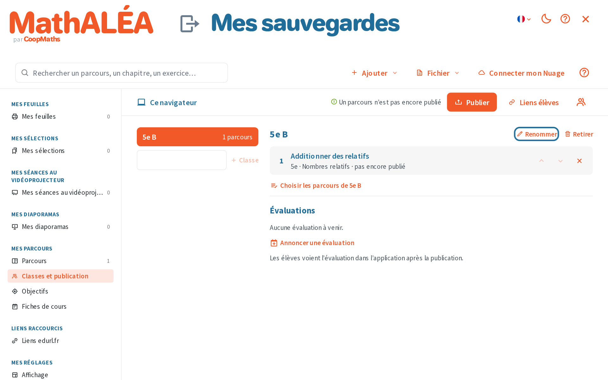

## 14. Annoncer une évaluation

Sous la classe, « Annoncer une évaluation » demande un titre facultatif, le jour (jj/mm/aaaa) et les parcours concernés. Après la publication, les élèves de la classe voient l'évaluation à l'accueil de l'application et peuvent la préparer : leurs révisions portent alors sur tous les exercices de ces parcours jusqu'au jour de l'évaluation.

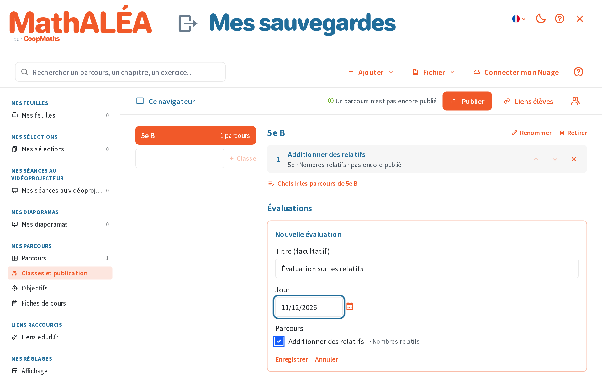
