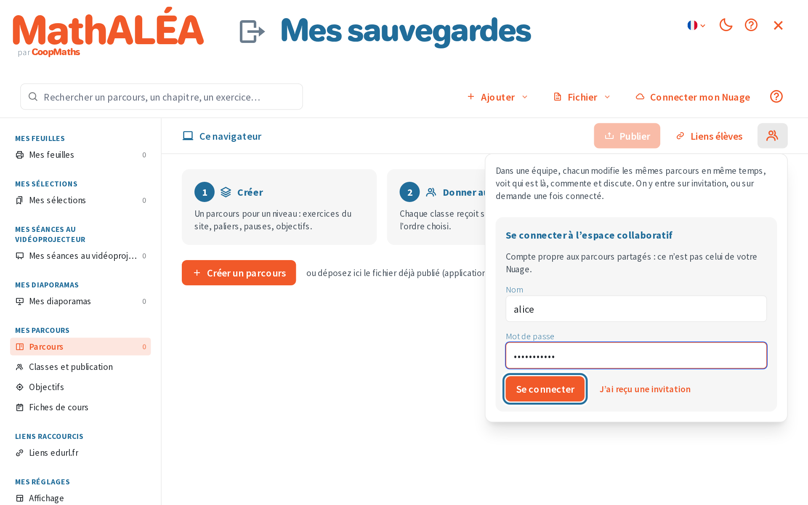
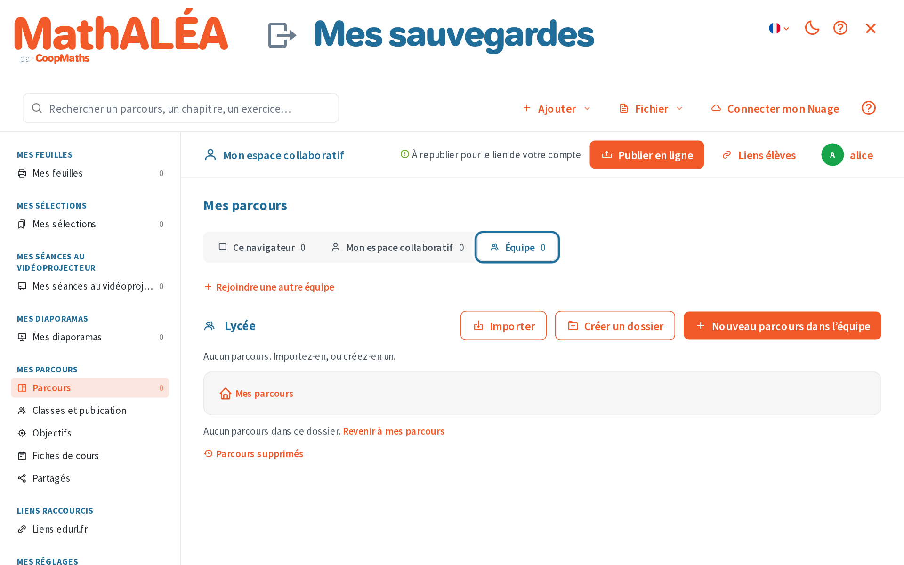
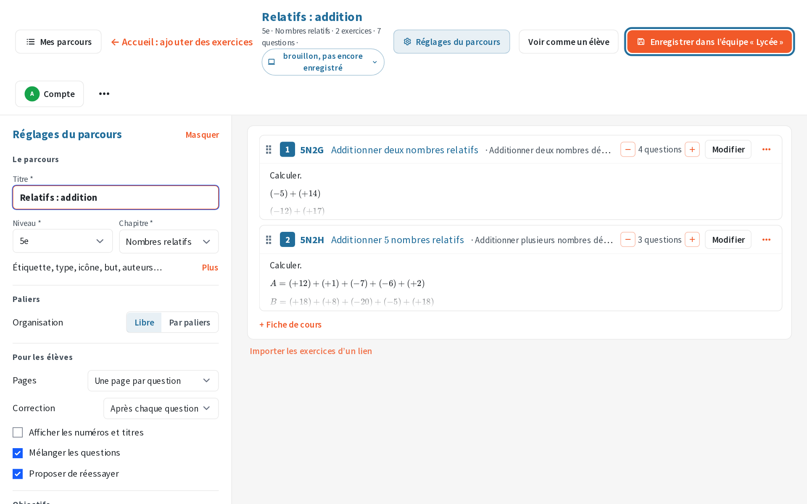
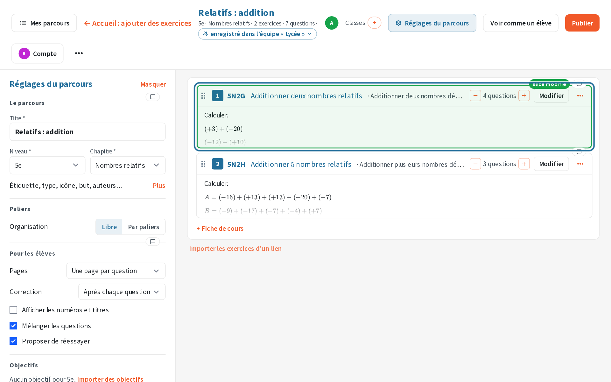
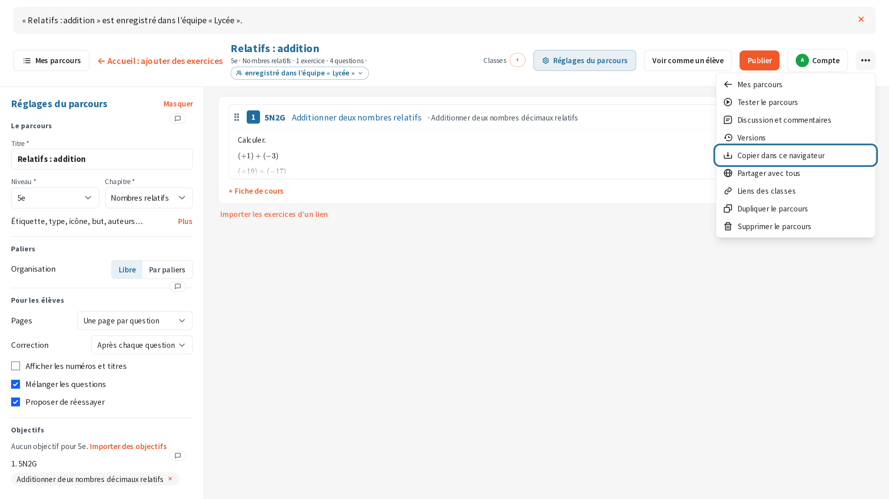
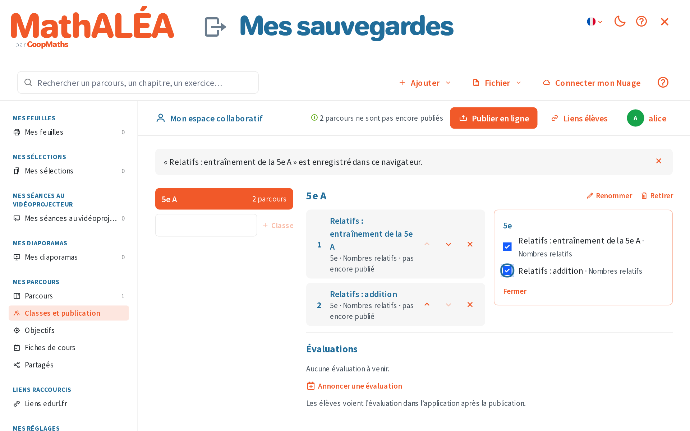
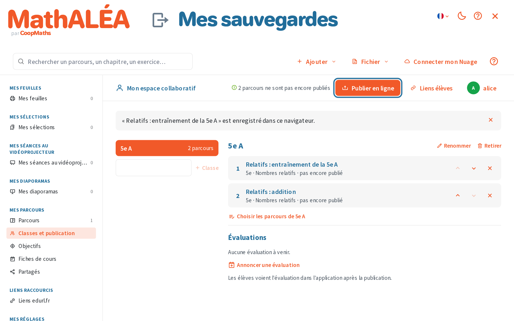
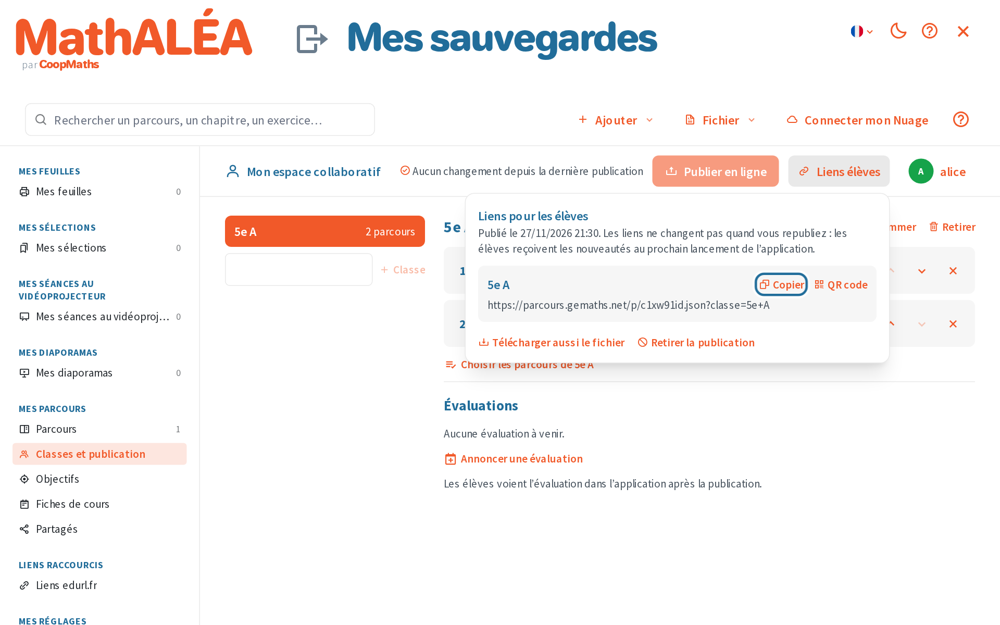
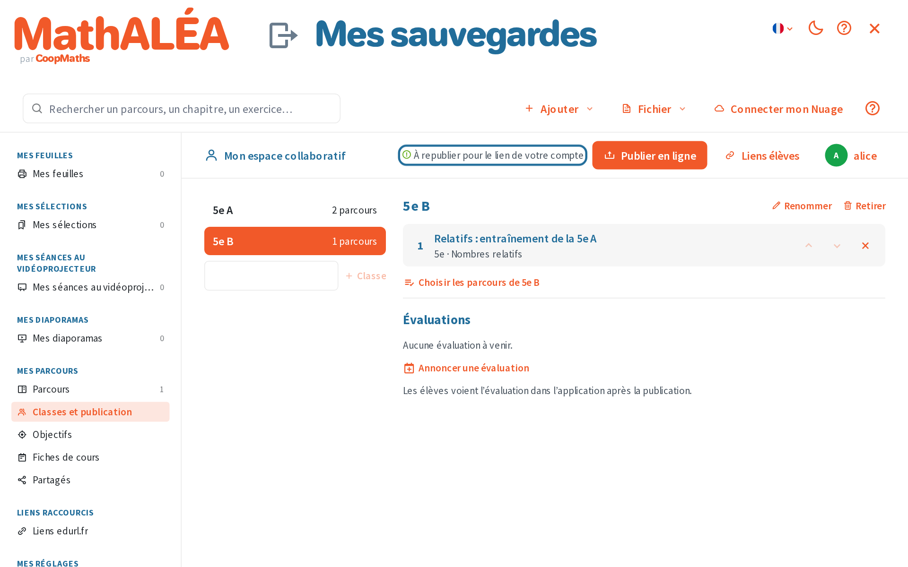
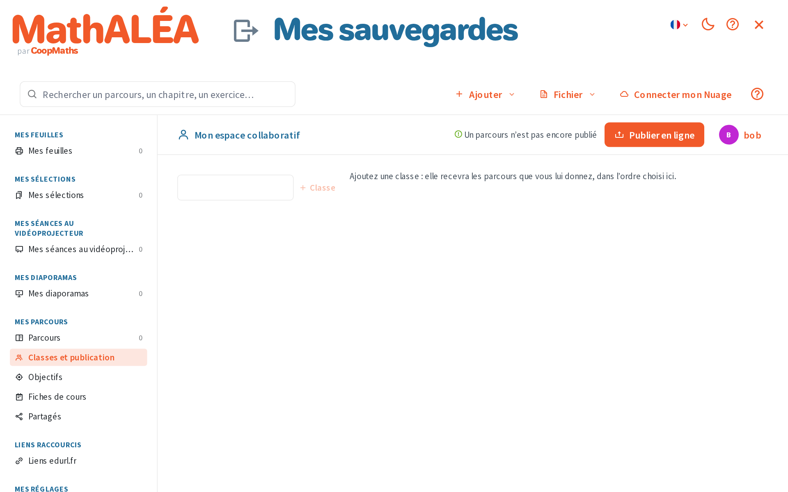

# Travailler en équipe

[Retour aux guides](index.md)

Avec un compte de l'espace collaboratif, plusieurs collègues préparent les mêmes parcours ensemble, chacun depuis son ordinateur. Les parcours sont partagés dans l'équipe ; les classes, elles, restent celles de chaque enseignant. Ce guide suppose connu [Créer un parcours et le publier avec le Nuage](parcours-nuage.md).

## 1. Se connecter

Dans Mes sauvegardes, rubrique « Parcours », cliquez sur l'icône du compte, en haut à droite. Saisissez votre nom et votre mot de passe, puis cliquez sur « Se connecter » ; la première fois, « J'ai reçu une invitation » crée le compte à partir du code d'invitation. Ce compte est propre aux parcours partagés : ce n'est pas celui du Nuage.

## 2. Les espaces

La liste des parcours a maintenant trois onglets : « Ce navigateur » (ou « Mon Nuage »), « Mon espace collaboratif », où vous retrouvez vos parcours depuis n'importe quel ordinateur, et l'équipe. L'icône du compte affiche vos équipes et leurs membres.

## 3. Un parcours dans l'équipe

Ouvrez l'onglet de l'équipe, puis créez le parcours comme d'habitude, depuis les exercices de l'accueil : il est enregistré dans l'espace ouvert en dernier, ici l'équipe « Lycée ». Le bouton le dit : « Enregistrer dans l'équipe « Lycée » ».

## 4. Modifier à plusieurs

Tous les membres de l'équipe voient le parcours et le modifient en même temps ; chaque changement arrive aussitôt chez les autres. Quand un collègue règle un exercice, sa carte porte son nom (« alice modifie ») et reste bloquée jusqu'à ce qu'il ait fini.

## 5. Copier, partager, retrouver une version

Le menu ⋯ d'un parcours d'équipe propose la discussion et les commentaires, les versions précédentes, « Copier dans ce navigateur » (une copie indépendante, que l'équipe ne voit pas) et « Partager avec tous », qui le met dans la bibliothèque commune (rubrique « Partagés ») où tous les comptes peuvent le copier.

## 6. Vos classes reçoivent aussi les parcours de l'équipe

Dans « Classes et publication », vos classes proposent tous vos parcours, ceux de ce navigateur comme ceux de l'équipe. Cochez ceux de la classe : ici, la 5e A reçoit un parcours de l'équipe et un parcours personnel.

## 7. Publier en ligne

Connecté, « Publier en ligne » envoie les parcours de toutes vos classes par le lien de votre compte (et dans votre Nuage, si vous y avez déjà publié). Le fichier contient les parcours tels qu'ils sont au moment de la publication.

## 8. Les liens des classes

Les liens s'affichent, un par classe, avec « Copier » et « QR code », comme pour le Nuage. Ils ne changent pas quand vous republiez.

## 9. Republier après un changement

Une modification n'arrive pas aux élèves toute seule, qu'elle vienne de vous (une classe ajoutée, un parcours donné à une classe) ou d'un collègue qui change un parcours de l'équipe : le fichier des élèves n'est mis à jour qu'à la publication suivante. La barre l'indique (« À republier pour le lien de votre compte ») ; cliquez de nouveau sur « Publier en ligne ». Chaque membre de l'équipe publie pour ses propres classes.

## 10. Les classes restent les vôtres

Vos collègues ne voient pas vos classes, et vous ne voyez pas les leurs. Chez un collègue de l'équipe, la rubrique « Classes et publication » ne montre que ses propres classes, même s'il a le même parcours sous les yeux.

