# Créer un parcours et le publier avec le Nuage

[Retour aux guides](index.md)

Les parcours de l'application se préparent sur le site MathALÉA, dans Mes sauvegardes, rubrique « Parcours ». Ce guide part des exercices choisis sur la page d'accueil du site et va jusqu'au lien que les élèves ajoutent dans l'application. Les fichiers des élèves sont rangés dans votre Nuage (apps.education.fr) ; un autre serveur Nextcloud convient aussi. Sur chaque image, le cadre bleu montre où cliquer.

Tant que les parcours sont en test sur le site, ces menus n'apparaissent qu'en ajoutant `&beta` à l'adresse de la page (par exemple `https://coopmaths.fr/alea/?beta`).

## 1. Connecter votre Nuage

Dans Mes sauvegardes, cliquez sur « Connecter mon Nuage », laissez le serveur nuage.apps.education.fr et cliquez sur « Se connecter ». Le Nuage s'ouvre dans un nouvel onglet : connectez-vous avec votre compte apps.education.fr et autorisez l'accès.

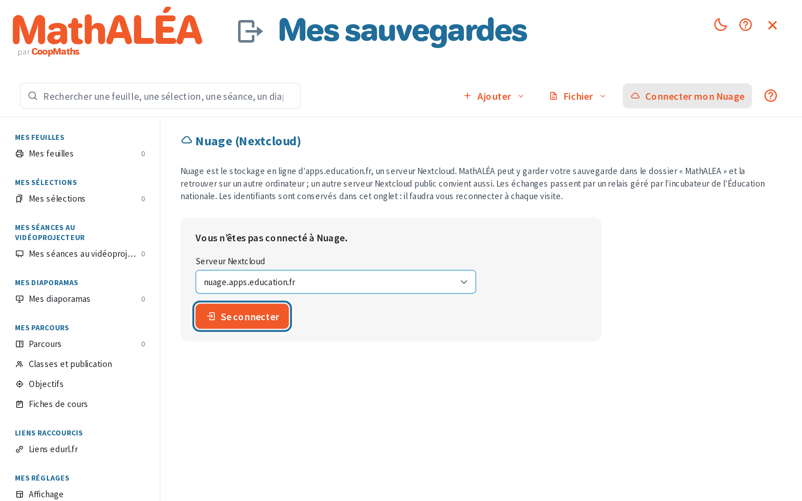

## 2. Connexion faite

La page indique le serveur et votre identifiant. La connexion vaut pour cet onglet : il faudra la refaire à votre prochaine visite.

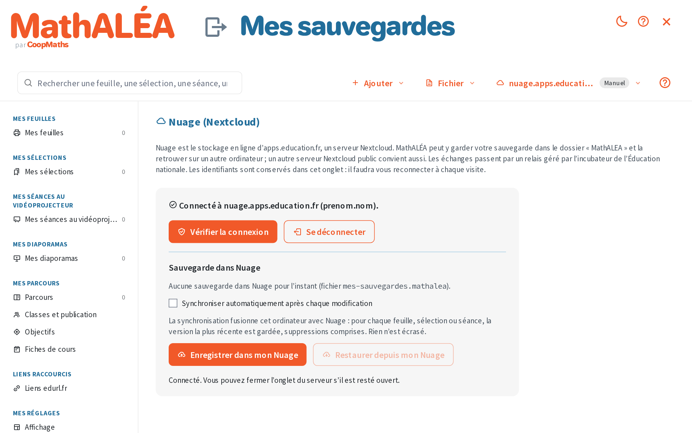

## 3. Choisir les exercices

Sur la page d'accueil du site, ajoutez les exercices comme d'habitude, depuis le menu de gauche. Réglez chacun avec ses paramètres (bouton à droite de son titre) : le nombre de questions et les options choisies ici sont celles du parcours.

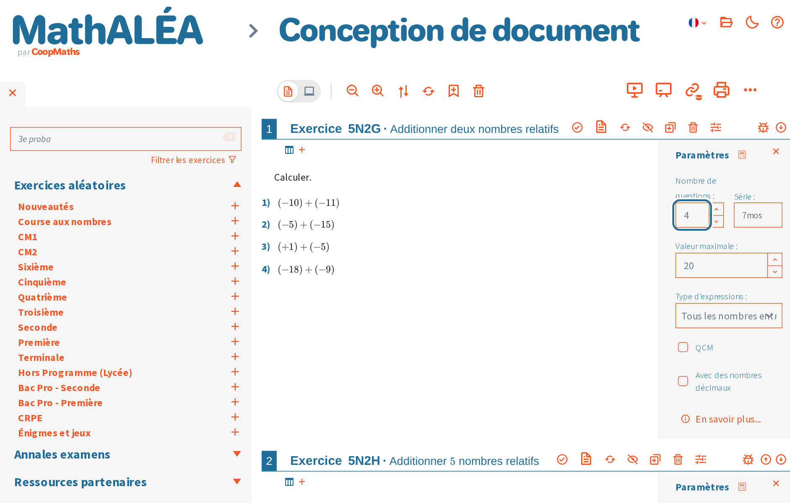

## 4. Nouveau parcours avec ces exercices

Cliquez sur les trois points en haut à droite, puis sur « Nouveau parcours avec ces exercices ».

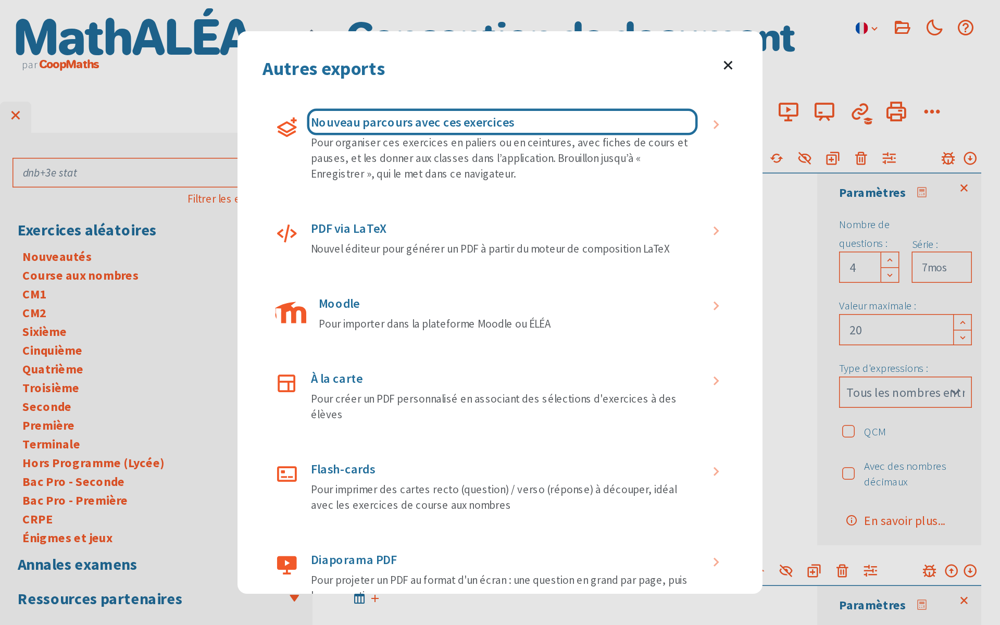

## 5. Le brouillon

L'éditeur s'ouvre avec vos exercices, chacun avec un aperçu de ses questions. Le parcours reste un brouillon tant qu'il n'est pas enregistré. Donnez-lui un titre.

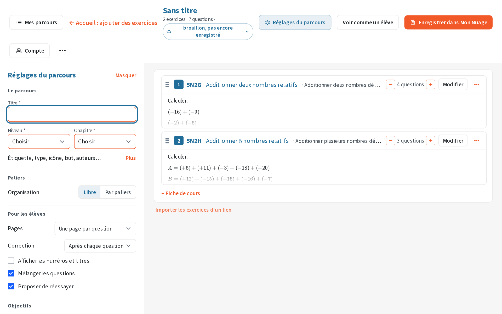

## 6. Enregistrer

Choisissez le niveau et le chapitre, puis cliquez sur « Enregistrer dans Mon Nuage ». Le parcours rejoint votre liste, sous son niveau et son chapitre.

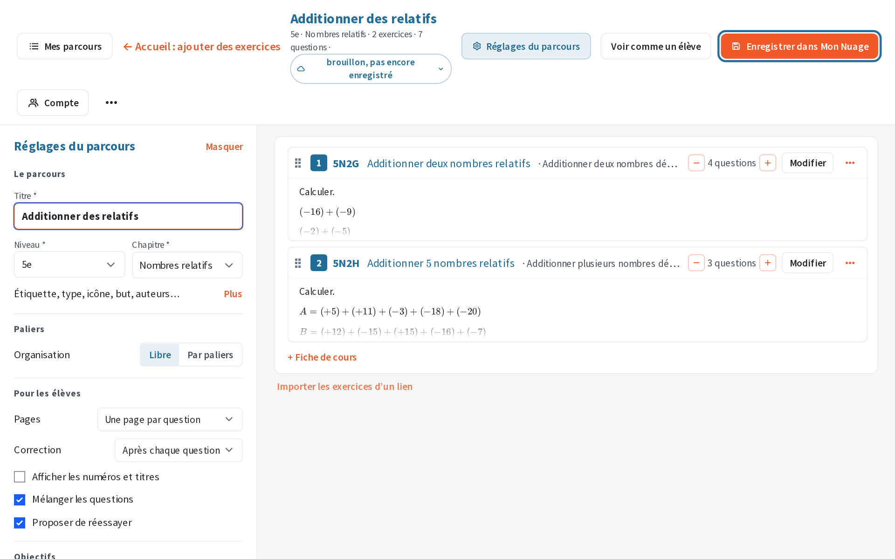

## 7. Créer une classe

Cliquez sur « Mes parcours », puis sur « Classes et publication » dans la colonne de gauche. Écrivez le nom de la classe et appuyez sur Entrée.

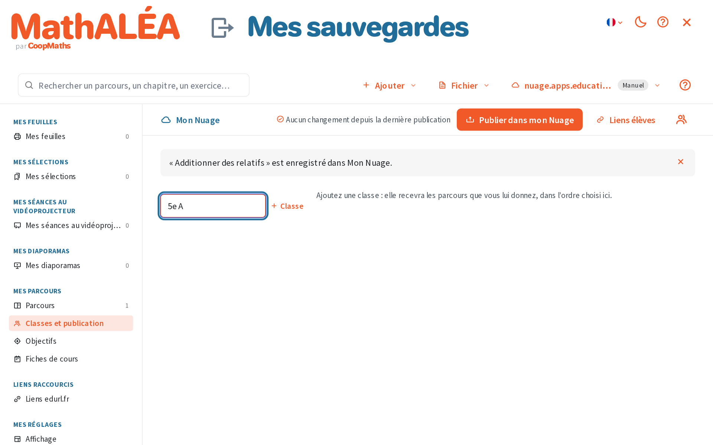

## 8. Donner le parcours à la classe

Cliquez sur « Choisir les parcours de 5e A » et cochez le parcours. Les élèves le verront dans l'ordre de cette liste, que les flèches modifient.

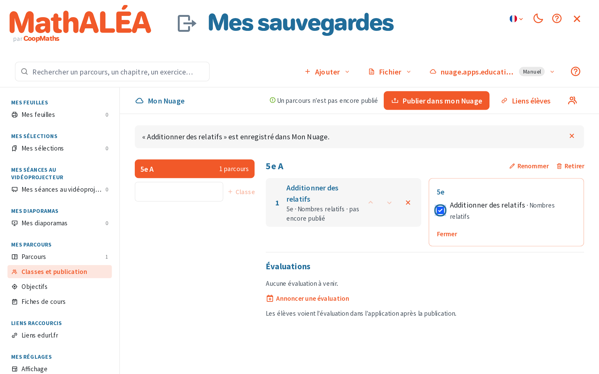

## 9. Publier

Cliquez sur « Publier dans mon Nuage ». Le site écrit le fichier des élèves dans le dossier MathALEA/Parcours élèves de votre Nuage et crée un lien de partage en lecture seule pour ce dossier.

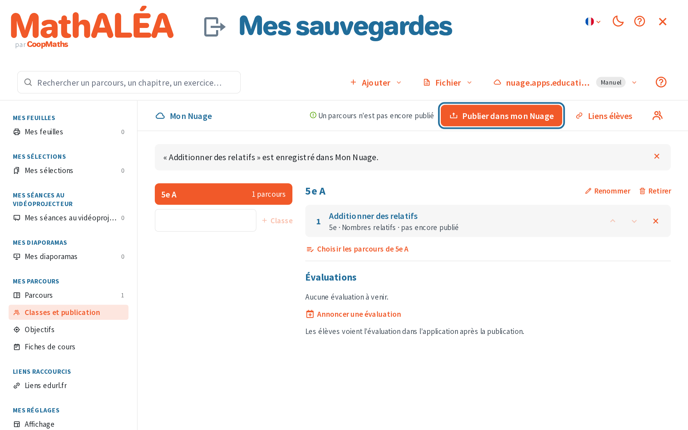

## 10. Le lien de la classe

Les liens s'affichent, un par classe. « Copier » le met dans le presse-papiers, pour l'ENT par exemple ; l'élève le colle une fois dans l'application. Ce lien ne change plus de l'année.

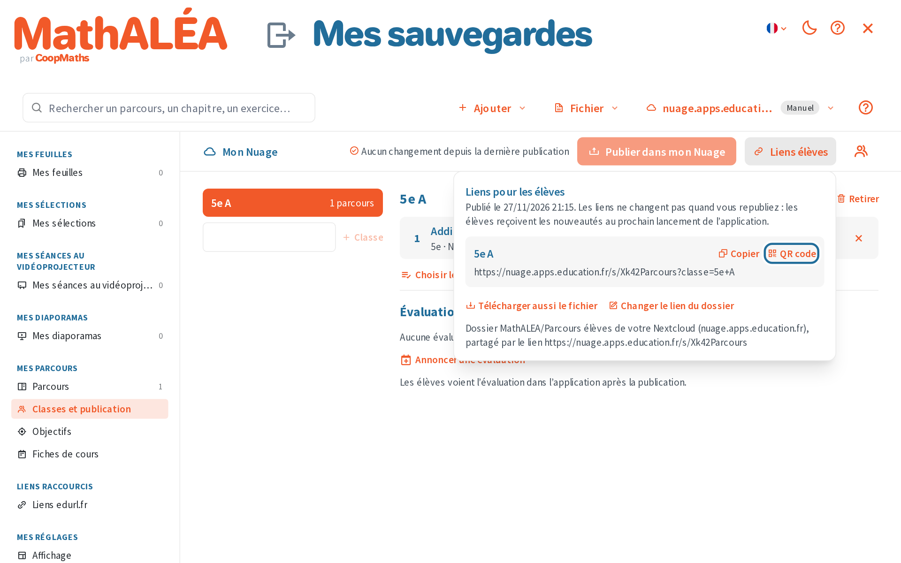

## 11. Le QR code de la classe

« QR code » affiche le même lien en QR code, à projeter en classe. Les élèves le scannent depuis l'accueil de l'application : le dossier est ajouté et leur classe choisie, sans rien saisir.

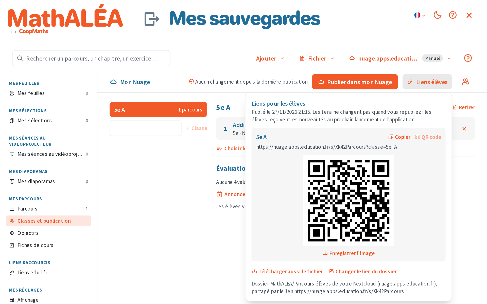

## 12. Après une modification, republier

Une modification (un exercice, un titre, une classe) reste sur le site tant que vous ne republiez pas : le fichier des élèves, dans le Nuage, n'est pas mis à jour avant. La barre le rappelle (« Un parcours n'est pas encore publié ») ; cliquez de nouveau sur « Publier dans mon Nuage ». Les élèves reçoivent la nouvelle version au lancement suivant de l'application, et leurs résultats sont gardés.

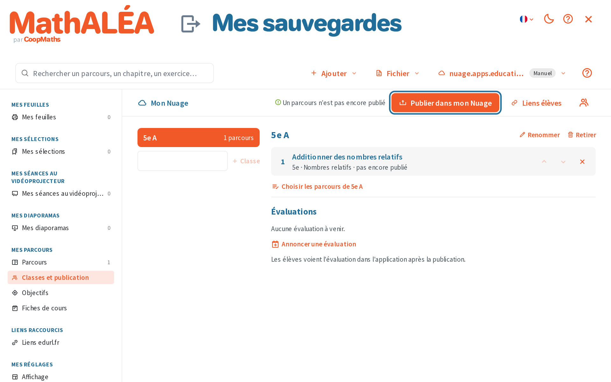

Pour aller plus loin (paliers, ceintures, réglages des exercices, évaluations) : [Les réglages du parcours](parcours-avance.md). Pour préparer des parcours avec des collègues : [Travailler en équipe](parcours-equipe.md).
