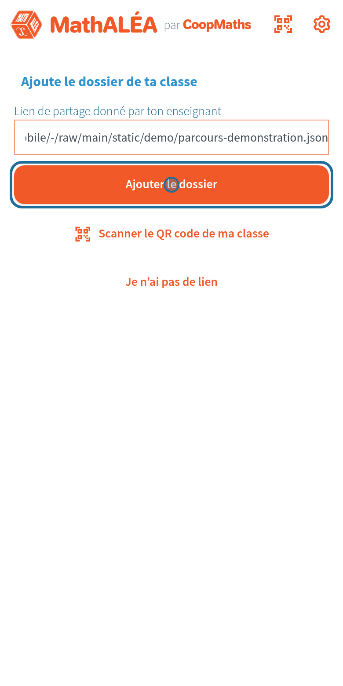
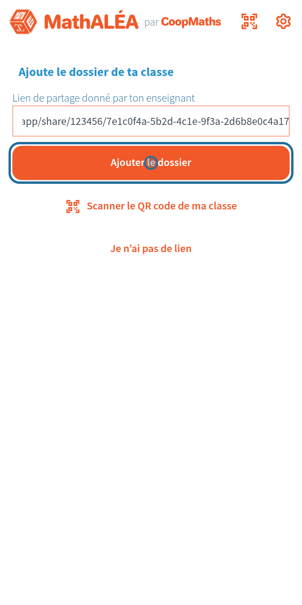

# Prise en main

[Retour aux guides](index.md)

En une demi-heure, vous préparez un parcours sur le site MathALÉA, vos élèves le reçoivent sur leur téléphone, et vous lancez une session en classe. Chaque étape renvoie à son guide détaillé, avec des images.

## 1. Installer

Android, iPhone, iPad, Windows, Mac ou Linux : voir [Installer l'application](installer.md). Pour l'iPhone en test : [Installer sur iPhone ou iPad](iphone.md).

## 2. Essayer en cinq minutes

Choisissez France ou Suisse, puis ajoutez le dossier de démonstration avec son lien (dans [Découvrir en cinq minutes](decouvrir.md)). Faites un parcours comme un élève : correction immédiate, clavier mathématique, paliers et ceintures.

## 3. Créer un parcours et le donner à une classe

Sur le site MathALÉA, choisissez et réglez les exercices sur l'accueil, puis « Nouveau parcours avec ces exercices » dans le menu des trois points : titre, niveau, chapitre, paliers ou ceintures. Dans « Classes et publication », créez la classe (5e B, par exemple) et cochez ses parcours.

Détails : [Créer un parcours et le publier avec le Nuage](parcours-nuage.md), puis [Les réglages du parcours](parcours-avance.md).

## 4. Publier pour les élèves

Connectez votre Nuage (apps.education.fr) dans Mes sauvegardes, puis cliquez sur « Publier dans mon Nuage » : le site range le fichier des élèves dans votre Nuage et donne un lien et un QR code par classe. Avec un compte de l'espace collaboratif, « Publier en ligne » fait de même par le lien de votre compte ([Travailler en équipe](parcours-equipe.md)). Sans l'un ni l'autre, « Publier » télécharge un fichier à déposer dans un dossier de votre drive partagé par lien. Après chaque changement, republiez : les élèves reçoivent la nouvelle version au prochain lancement.

## 5. Côté élèves

Le plus simple : le QR code de la classe, affiché par « Liens élèves » après la publication. Projetez-le : les élèves le scannent depuis leur accueil, le dossier est ajouté et leur classe choisie, sans rien saisir. Sinon, donnez-leur le lien (sur l'ENT par exemple) : ils le collent une fois sur leur accueil. Ensuite, chaque publication leur arrive toute seule, et ils travaillent même sans connexion.

Détails : [Côté élève](eleves.md).

## 6. En classe

Sur la page d'un parcours, « Autres actions », « Session partagée » : un code et son QR code. Projetez le QR code : les élèves le scannent depuis leur accueil et ont tous les mêmes questions. Un élève peut aussi créer une session pour travailler avec ses camarades.

Détails : [Sessions partagées](sessions.md).

## Et ensuite

Tout ce que fait l'application, fonction par fonction : [le guide complet](guide-complet.md).
