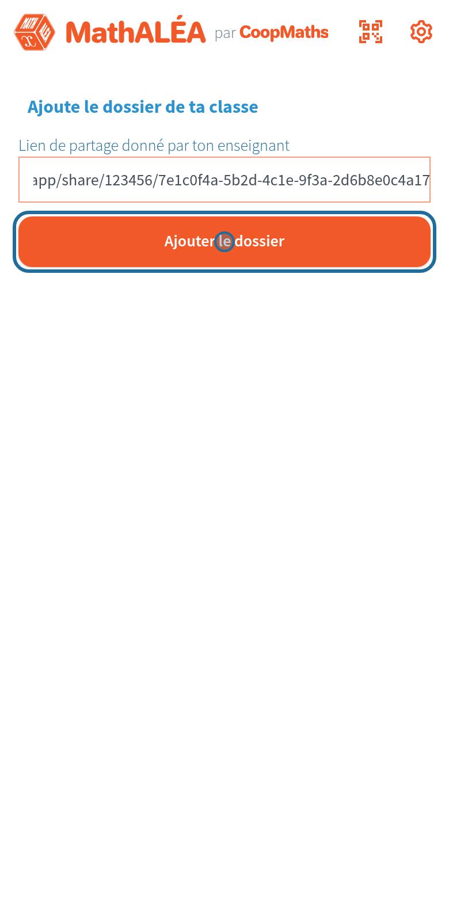

# Prise en main

[Retour aux guides](index.md)

En une demi-heure, vous préparez un parcours, vos élèves le reçoivent sur leur téléphone, et vous lancez une session en classe. Chaque étape renvoie à son guide détaillé, avec des images.

## 1. Installer

Android, iPhone, iPad, Windows, Mac ou Linux : voir [Installer l'application](installer.md). Pour l'iPhone en test : [Installer sur iPhone ou iPad](iphone.md).

## 2. Essayer en cinq minutes

Choisissez France ou Suisse. Dans les Réglages (roue dentée), activez **Je suis enseignant**, puis touchez **Charger les parcours de démonstration**. Faites un parcours comme un élève : correction immédiate, clavier mathématique, paliers et ceintures.

Détails : [Découvrir en cinq minutes](decouvrir.md).

## 3. Créer un parcours

Onglet **Créer**, « Créer un parcours ». Un seul écran : niveau, chapitre, titre, puis « Ajouter des exercices » ouvre les exercices de MathALÉA, rangés comme sur le site, avec leurs réglages et un aperçu. « Valider le parcours ».

Détails : [Créer un parcours](creer.md).

## 4. Le donner à une classe

Onglet Créer, vue **Classes** : « + » crée la classe (5e B, par exemple), puis cochez ses parcours. On crée pour un niveau ; on donne à autant de classes qu'on veut.

## 5. Publier pour les élèves

Une seule fois : créez sur votre drive (kDrive, Dropbox, Nextcloud, le Nuage d'apps.education.fr…) un dossier partagé par lien, et collez ce lien dans la Mise en route de l'onglet Créer.

Puis, à chaque changement : la bannière en haut propose **Mettre à jour**. L'application enregistre un fichier ; déposez-le dans ce dossier. C'est tout.

## 6. Côté élèves

Donnez-leur le lien du dossier (projeté, sur l'ENT, en QR code). Ils le collent une fois sur leur accueil. Ensuite, chaque publication leur arrive toute seule, et ils travaillent même sans connexion.

Détails : [Côté élève](eleves.md).

## 7. En classe

Onglet **En classe**, « Nouvelle session » : choisissez un parcours, puis « Lancer la session ». Projetez le QR code : les élèves le scannent depuis leur accueil et ont tous les mêmes questions. À la fin, lisez leurs QR codes de réponses : l'application vous montre ce que la classe a réussi et les erreurs fréquentes.

Détails : [Sessions et réponses de la classe](sessions.md).

## Et ensuite

Tout ce que fait l'application, fonction par fonction : [le guide complet](guide-complet.md).
