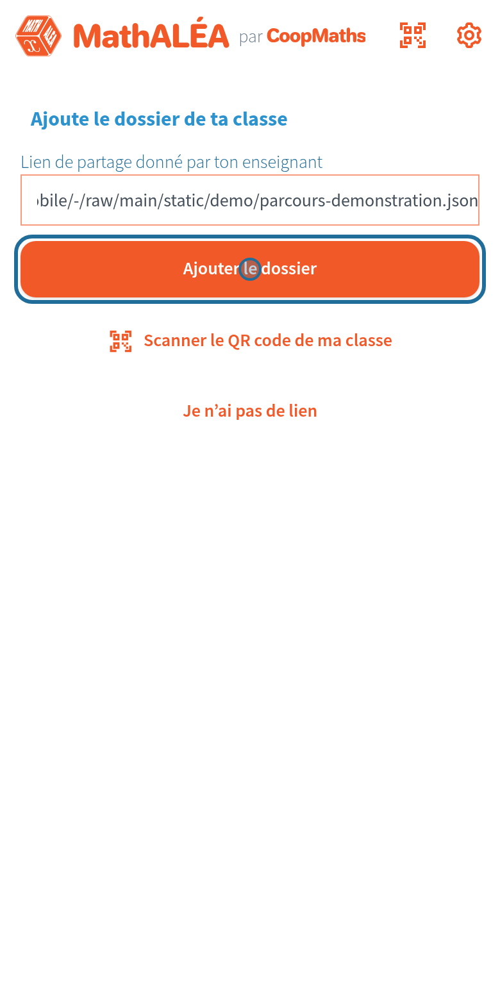
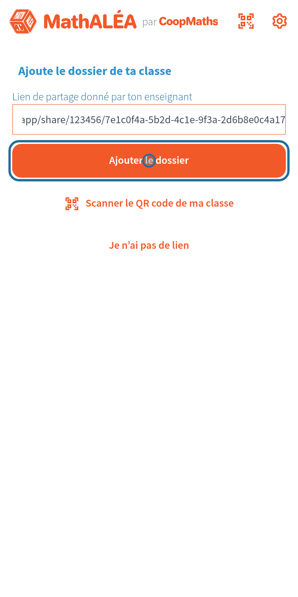

# Prise en main

[Retour aux guides](index.md)

En une demi-heure, vous préparez un parcours sur le site MathALÉA, vos élèves le reçoivent sur leur téléphone, et vous lancez une session en classe. Chaque étape renvoie à son guide détaillé, avec des images.

## 1. Installer

Android, iPhone, iPad, Windows, Mac ou Linux : voir [Installer l'application](installer.md). Pour l'iPhone en test : [Installer sur iPhone ou iPad](iphone.md).

## 2. Essayer en cinq minutes

Choisissez France ou Suisse, puis ajoutez le dossier de démonstration avec son lien (dans [Découvrir en cinq minutes](decouvrir.md)). Faites un parcours comme un élève : correction immédiate, clavier mathématique, paliers et ceintures.

## 3. Créer un parcours et le donner à une classe

Sur le site MathALÉA, page « Parcours pour l'application » : niveau, chapitre, titre, exercices (rangés comme sur le site, avec leurs réglages), paliers ou ceintures. Puis l'onglet Classes : créez la classe (5e B, par exemple) et cochez ses parcours. « Publier » télécharge le fichier.

Détails : [Créer un parcours sur le site](creer-sur-le-site.md).

## 4. Publier pour les élèves

Une seule fois : créez sur votre drive (kDrive, Dropbox, Nextcloud, le Nuage d'apps.education.fr…) un dossier partagé par lien. Puis, à chaque changement, déposez le nouveau fichier dans ce dossier. C'est tout : les élèves reçoivent la nouvelle version au prochain lancement.

## 5. Côté élèves

Le plus simple : un QR code du lien du dossier suivi de `?classe=5B`. Projetez-le : les élèves le scannent depuis leur accueil, le dossier est ajouté et leur classe choisie, sans rien saisir. Sinon, donnez-leur le lien (sur l'ENT par exemple) : ils le collent une fois sur leur accueil. Ensuite, chaque publication leur arrive toute seule, et ils travaillent même sans connexion.

Détails : [Côté élève](eleves.md).

## 6. En classe

Sur la page d'un parcours, « Autres actions », « Session partagée » : un code et son QR code. Projetez le QR code : les élèves le scannent depuis leur accueil et ont tous les mêmes questions. Un élève peut aussi créer une session pour travailler avec ses camarades.

Détails : [Sessions partagées](sessions.md).

## Et ensuite

Tout ce que fait l'application, fonction par fonction : [le guide complet](guide-complet.md).
