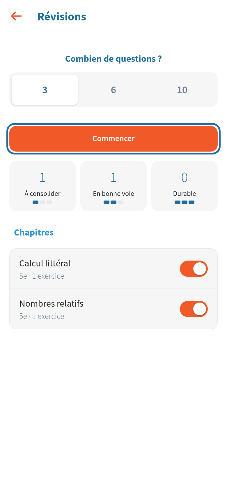
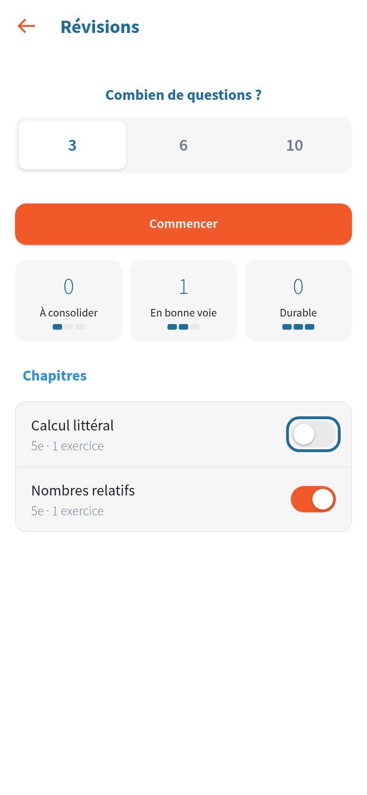
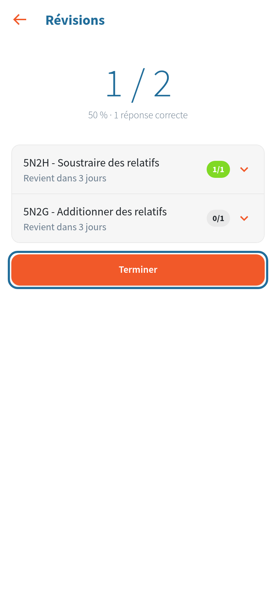

# Révisions

[Retour aux guides](index.md)

Un parcours se travaille une ou deux fois, puis on passe à autre chose. Les révisions font revenir, au bon moment, les exercices déjà faits, avec de nouvelles valeurs. Tout se calcule dans l'application, à partir de ce que l'élève a fait. L'enseignant n'a rien à régler. Sur chaque image, le cercle bleu montre où toucher.

## 1. Quand un exercice revient

Chaque exercice d'un parcours terminé entre dans les révisions. Il revient :

- le lendemain s'il a été réussi à moins de 50 % ;
- dans 3 jours entre 50 et 79 % ;
- dans une semaine à 80 % et plus.

À chaque révision, un exercice réussi revient plus tard (3 semaines, puis 2 mois) ; un exercice manqué revient plus tôt. Un exercice revu tous les deux mois sans erreur est « durable ».

Les exercices sur papier et Teste ton niveau n'entrent pas dans les révisions.

## 2. Réviser

En haut de « Mes parcours », la tuile « Révisions » indique s'il y a des exercices à revoir aujourd'hui, ou quand aura lieu la prochaine révision.

Choisissez le nombre de questions : 3, 6 ou 10, puis touchez « Commencer ». L'application retient ce choix. Elle n'affiche jamais un nombre d'exercices en retard : on avance à son rythme, et ce qui n'est pas fait aujourd'hui attend la séance suivante, sans pénalité. Les exercices les plus fragiles passent en premier.

Chaque question vient d'un exercice différent, de chapitres différents, sans le titre de l'exercice : il faut reconnaître seul de quel type de problème il s'agit. C'est plus difficile qu'un parcours, et c'est ce qui fait retenir. Les trois cases montrent la solidité des exercices : à consolider, en bonne voie, durable.

## 3. Choisir ses chapitres

Par défaut, tous les chapitres sont révisés. Pour se concentrer sur certains (avant une évaluation, par exemple), décochez les autres. Les nouveaux chapitres sont inclus tant que tous sont cochés.

## 4. Après la révision

Le bilan dévoile le titre de chaque exercice et dit quand il reviendra.

Dans le Suivi, chaque objectif indique aussi sa solidité dans le temps (« révision : en bonne voie »). Une ceinture obtenue n'est jamais retirée : les révisions l'entretiennent.
