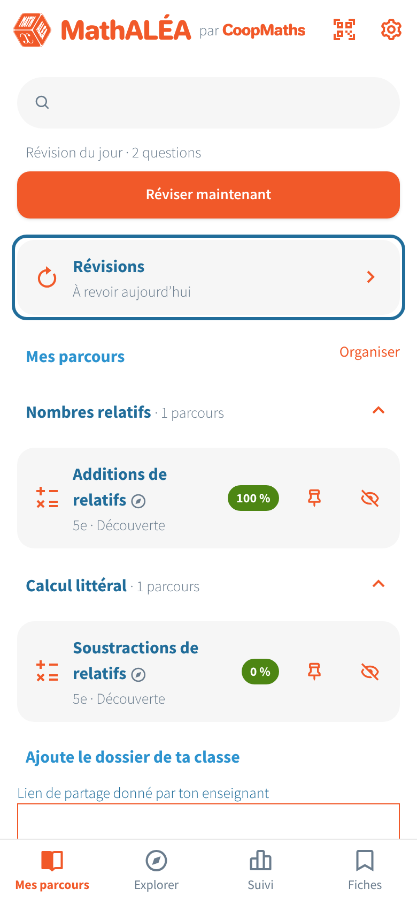
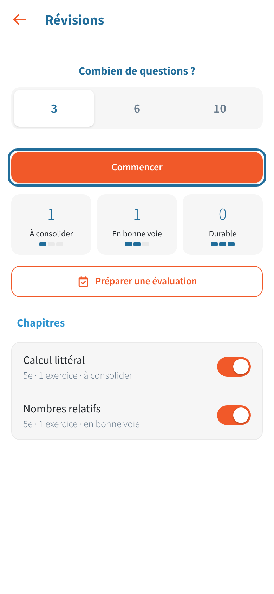
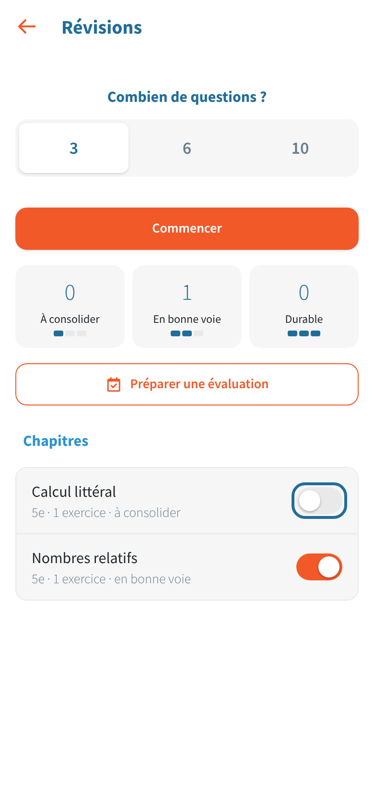
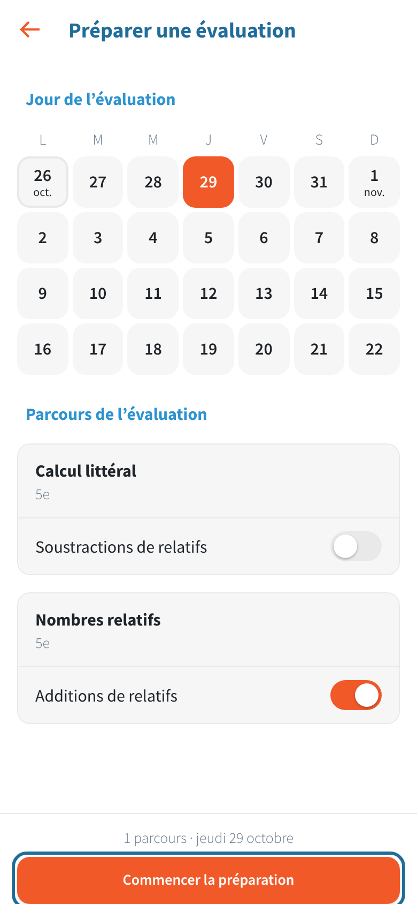
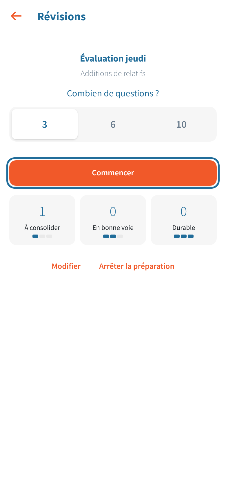
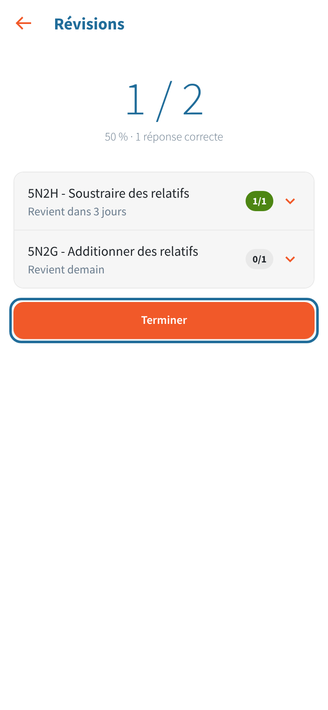

# Révisions

[Retour aux guides](index.md)

Un parcours se travaille une ou deux fois, puis on passe à autre chose. Les révisions font revenir, au bon moment, les exercices déjà faits, avec de nouvelles valeurs. Tout se calcule dans l'application, à partir de ce que l'élève a fait. L'enseignant n'a rien à régler. Sur chaque image, le cercle bleu montre où toucher.

## 1. Quand un exercice revient

Chaque exercice d'un parcours terminé entre dans les révisions. Il revient :

- le lendemain s'il a été réussi à moins de 50 % ;
- dans 3 jours entre 50 et 79 % ;
- dans une semaine à 80 % et plus.

À chaque révision, un exercice réussi revient plus tard (3 semaines, puis 2 mois). Un exercice manqué revient dès le lendemain ; réussi ce jour-là, il repart d'un cran plus bas qu'avant l'erreur. Un exercice revu tous les deux mois sans erreur est « durable ».

Les exercices sur papier et Teste ton niveau n'entrent pas dans les révisions.

## 2. Réviser

En haut de « Mes parcours », la tuile « Révisions » indique s'il y a des exercices à revoir aujourd'hui, ou quand aura lieu la prochaine révision.

Choisissez le nombre de questions : 3, 6 ou 10, puis touchez « Commencer ». L'application retient ce choix. Elle n'affiche jamais un nombre d'exercices en retard : on avance à son rythme, et ce qui n'est pas fait aujourd'hui attend la séance suivante, sans pénalité. Les exercices les plus fragiles passent en premier.

Chaque question vient d'un exercice différent, de chapitres différents, sans le titre de l'exercice : il faut reconnaître seul de quel type de problème il s'agit. C'est plus difficile qu'un parcours, et c'est ce qui fait retenir. Les trois cases montrent la solidité des exercices : à consolider, en bonne voie, durable.

## 3. Choisir ses chapitres

Par défaut, tous les chapitres sont révisés. Pour en laisser un de côté, décochez-le. Un chapitre commencé plus tard est toujours révisé. Chaque chapitre indique sa solidité (à consolider, en bonne voie, durable).

## 4. Préparer une évaluation

Une évaluation arrive : touchez « Préparer une évaluation », puis le jour de l'évaluation et les parcours concernés. Les parcours sont rangés par chapitre ; un parcours du chapitre qui n'est pas au programme de l'évaluation reste simplement décoché.

Jusqu'au jour de l'évaluation :

- les séances de révision ne portent que sur ces parcours, sans attendre la date prévue de chaque exercice ; les plus fragiles passent en premier ;
- un exercice manqué revient dans la série suivante ;
- quand tout a été réussi dans la journée, l'application le dit ; « Refaire une série » reste possible ;
- les parcours choisis qui ne sont pas terminés sont rappelés sous « À finir avant l'évaluation » : seuls les exercices déjà faits peuvent être révisés ;
- l'accueil propose « Réviser pour l'évaluation ».

Réviser beaucoup la veille ne rend pas un exercice « durable » : réussi avant sa date, il garde sa place dans les révisions. Le lendemain de l'évaluation, les révisions habituelles reprennent toutes seules, sur tous les chapitres. « Modifier » change le jour ou les parcours, « Arrêter la préparation » y met fin plus tôt.

## 5. Après la révision

Le bilan dévoile le titre de chaque exercice et dit quand il reviendra.

Dans le Suivi, chaque objectif indique aussi sa solidité dans le temps (« révision : en bonne voie »). Une ceinture obtenue n'est jamais retirée : les révisions l'entretiennent.

## 6. Les barrettes

Comme au judo, une ceinture obtenue gagne des barrettes. La première arrive quand tous ses exercices sont réussis de nouveau une semaine plus tard, en révision. La deuxième arrive trois semaines après : la ceinture est alors « durable ». Le bilan de la révision l'annonce (« Barrette gagnée »), et les barrettes se voient sur la ceinture dans le Suivi et sur la page du parcours. Une barrette gagnée n'est jamais retirée.
