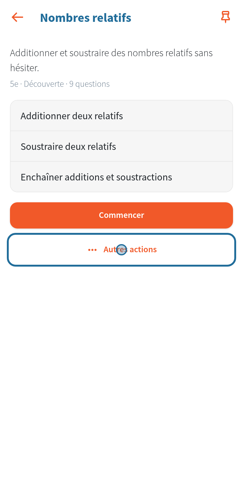
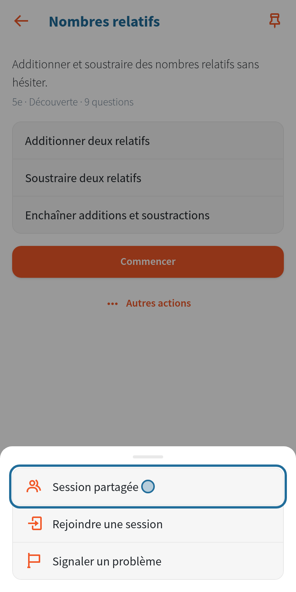
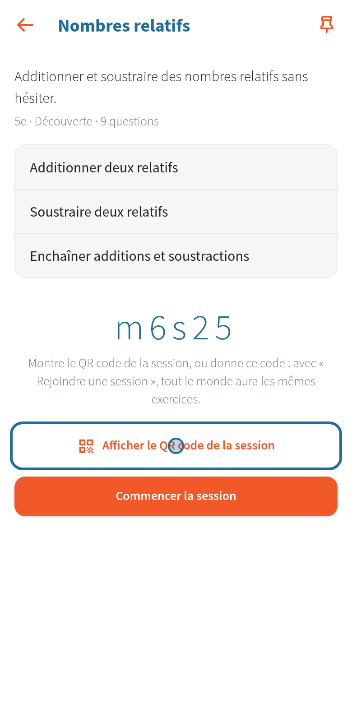
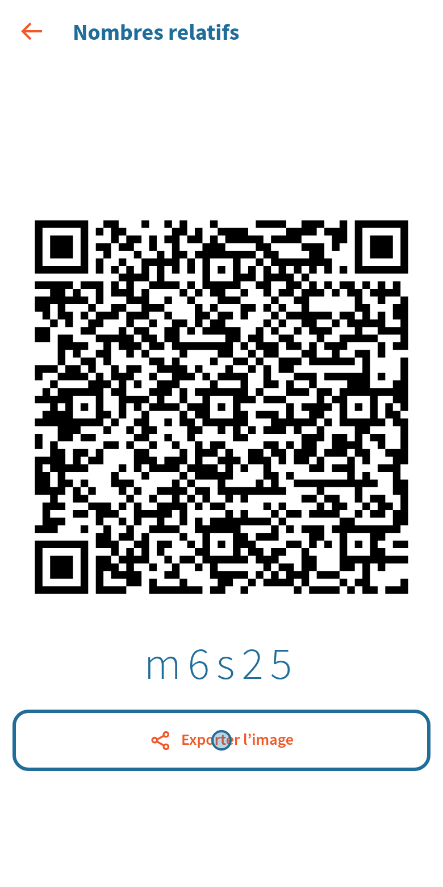
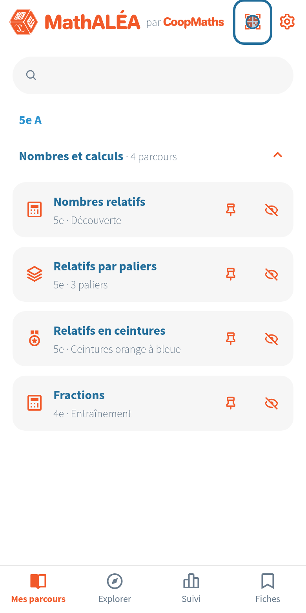

# Sessions partagées

[Retour aux guides](index.md)

Une session partagée donne à tout un groupe les mêmes questions, grâce à un code de cinq caractères. N'importe qui peut la créer : l'enseignant au tableau, ou un élève pour travailler avec ses camarades. Rien ne passe par un serveur. Sur chaque image, le cercle bleu montre où toucher.

## 1. Créer la session

Sur la page du parcours, touchez « Autres actions ».

Touchez « Session partagée ».

Le code de la session s'affiche. Avec des paliers ou des ceintures, choisissez d'abord le palier de la session : tout le monde aura ses exercices. Touchez « Afficher le QR code de la session » pour le montrer ou le projeter, puis « Commencer la session » pour la faire vous aussi.

## 2. Montrer le QR code

Le QR code s'affiche en grand, avec le code. « Exporter l'image » l'enregistre ou le partage (pour le projeter, ou le déposer sur l'ENT). Le bouton retour le referme.

Le QR code contient le code de la session, le parcours et sa version, et le lien du dossier de la classe : un élève qui n'avait pas encore ajouté la classe la reçoit en même temps que la session. Il ne contient aucune donnée d'élève.

## 3. Rejoindre la session

**Par le QR code** : sur l'accueil, l'élève touche l'icône QR code en haut et le vise. Il arrive directement dans la session, sur le bon parcours et le bon palier. Le parcours s'ajoute à son accueil.

**Par le code** : sur la page du même parcours, « Autres actions », « Rejoindre une session », puis le code.

## Bon à savoir

- Même code, même parcours, même version : mêmes questions. Si un élève a une autre version du parcours, l'application le lui dit : chacun vérifie sa connexion, puis on crée une nouvelle session.
- Si l'application d'un élève a des exercices plus anciens que ceux de la personne qui a créé la session, elle lui propose de la mettre à jour ; il peut continuer quand même, mais certaines questions peuvent être différentes.
- Le QR code d'une classe (le lien du dossier, voir [Côté élève](eleves.md)) se scanne avec la même icône.
