# Sessions et réponses de la classe

[Retour aux guides](index.md)

Une session partagée donne à toute la classe les mêmes questions, grâce à un code de cinq caractères. Si vous le demandez en créant la session, chaque élève vous montre ensuite ses réponses par un QR code : vous voyez en quelques minutes ce que la classe a réussi, quelles erreurs reviennent et où en est chaque élève. Rien ne passe par un serveur, et aucun prénom ne circule sauf si vous le demandez. Sur chaque image, le cercle bleu montre où toucher.

## 1. Créer la session et demander le QR code

Dans un parcours, touchez « Session pour la classe ». Ou bien, dans l'onglet En classe, touchez « Nouvelle session » et choisissez le parcours.

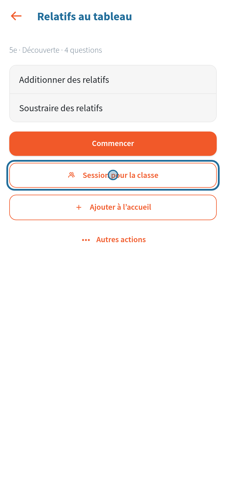

Un panneau s'ouvre. Allumez « QR code des réponses pour l'enseignant ».

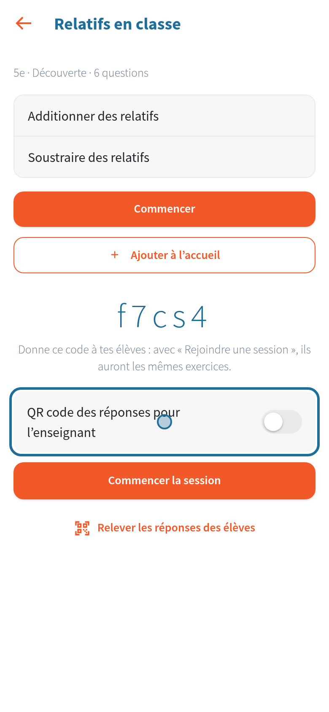

Choisissez ensuite quand l'élève montre son QR code :

- **Après la correction** : les élèves voient la correction comme d'habitude, puis montrent leur QR code depuis leur bilan.
- **Avant la correction** : aucune correction pendant la session. À la fin, chaque élève montre son QR code, puis voit ses résultats et les corrections. Vous recevez ainsi des réponses données sans avoir vu les corrections.

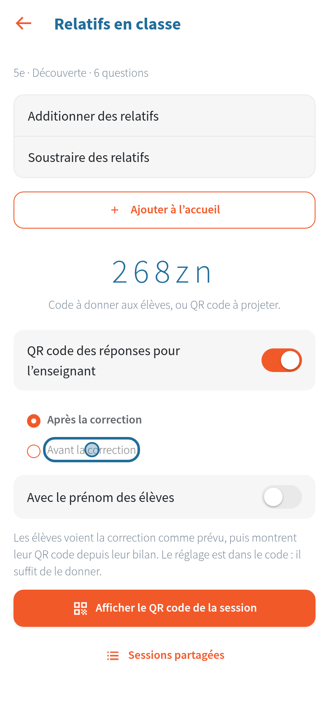

Pour savoir qui a répondu quoi, allumez aussi « Avec le prénom des élèves ». Le prénom ne va que sur votre appareil : il n'est jamais envoyé à une IA. Sans cette option, les élèves apparaissent comme « Élève 1, 2, 3… », dans l'ordre de lecture.

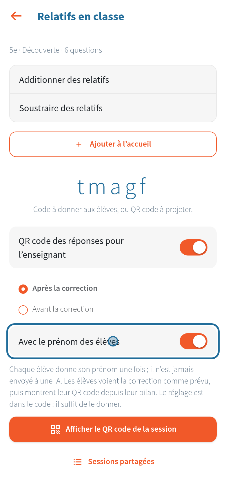

Touchez « Lancer la session ».

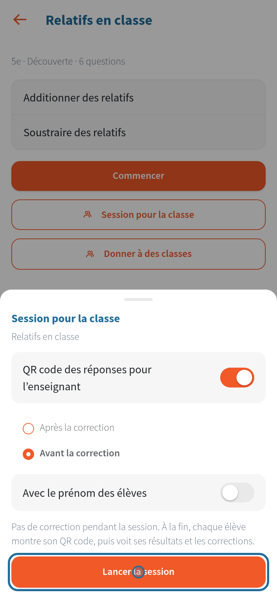

### La page de la session

« Lancer la session » ouvre directement la page de la session, dans l'onglet En classe : son QR code et son code. Vous ne faites pas la session vous-même : projetez cette page (« Plein écran » agrandit le QR code et permet d'exporter son image). Les élèves peuvent aussi taper le code avec « Rejoindre une session ».

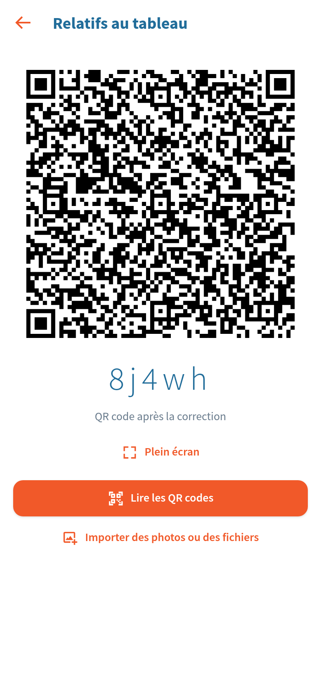

Le réglage est caché dans le code lui-même. Un élève ne peut pas le changer en modifiant le code : une autre lettre donne un réglage imprévisible et d'autres questions, et ses réponses arriveraient sous un autre code. Sans QR code des réponses, la session se déroule comme avant.

L'élève touche l'icône QR code en haut de son accueil et vise le tableau : il arrive directement dans la session, sur le bon parcours et le bon palier, même s'il n'avait pas ce parcours. Le parcours s'ajoute à son accueil.

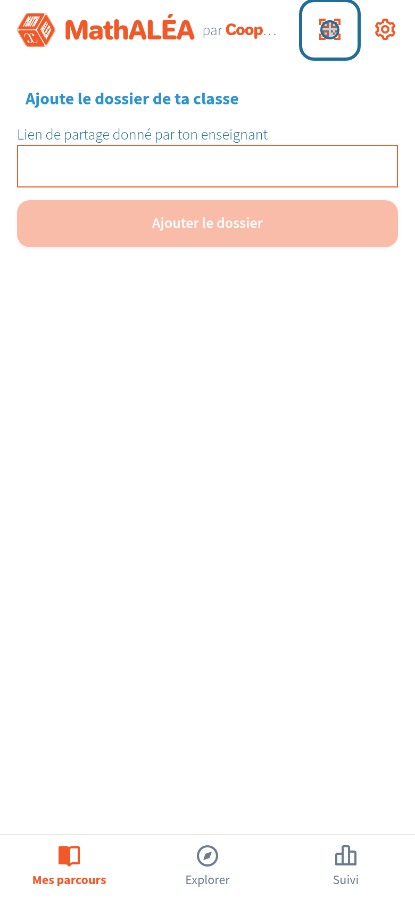

Si son application a des exercices plus anciens que les vôtres, elle lui demande de la mettre à jour ; il peut continuer quand même, mais certaines questions seront différentes.

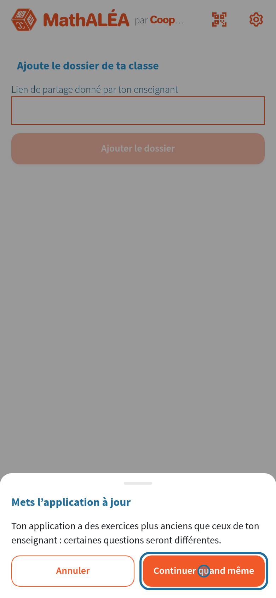

La session est gardée dans l'onglet En classe : vous pouvez la préparer avant le cours et réafficher son QR code en classe.

## 2. Ce que fait l'élève

**Après la correction.** À la fin, son bilan propose « Montrer mes réponses à l'enseignant ».

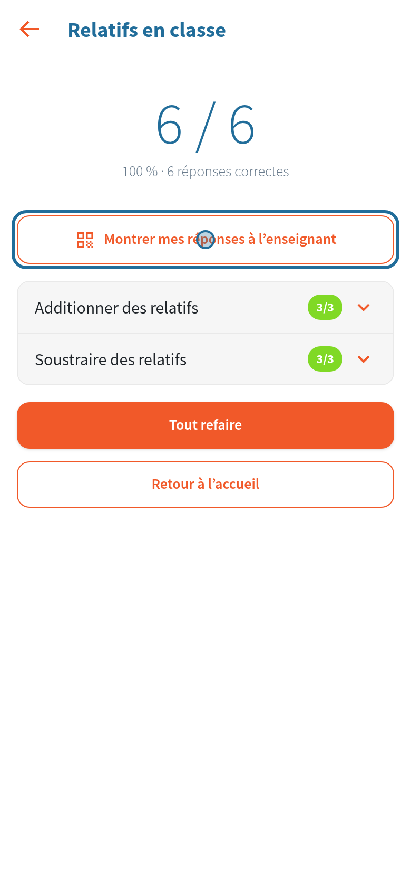

Si vous avez demandé le prénom, l'élève le tape une fois avant son premier QR code ; l'application le retient et il peut le corriger.

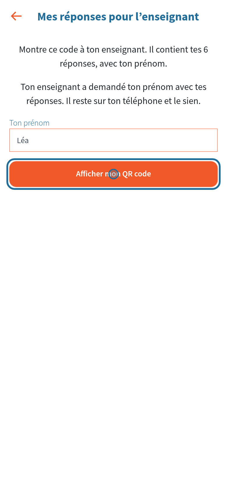

Le QR code s'affiche, sur fond blanc, avec ses réponses (et son prénom si vous l'avez demandé). S'il ne peut pas vous le montrer, « Envoyer un fichier à la place » vous l'envoie (messagerie de l'ENT, courriel…).

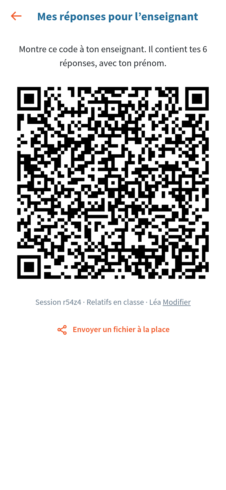

**Avant la correction.** Quand il soumet sa tentative, le QR code s'affiche d'abord, sans score ni correction. Une fois que vous l'avez lu, l'élève touche « C'est fait : voir mes résultats ». Le bouton retour ne dévoile rien : tant que le QR code n'a pas été montré, le passage indique « QR code à montrer ».

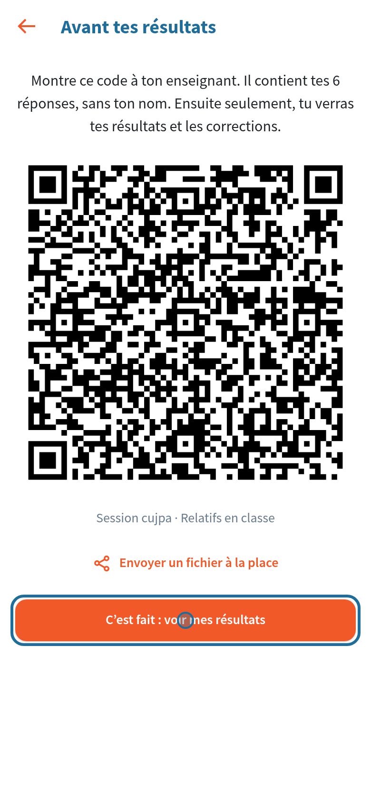

## 3. Retrouver ses sessions et lire les QR codes

Toutes vos sessions sont dans l'onglet En classe, en bas de l'écran (il apparaît avec le réglage « Je suis enseignant »).

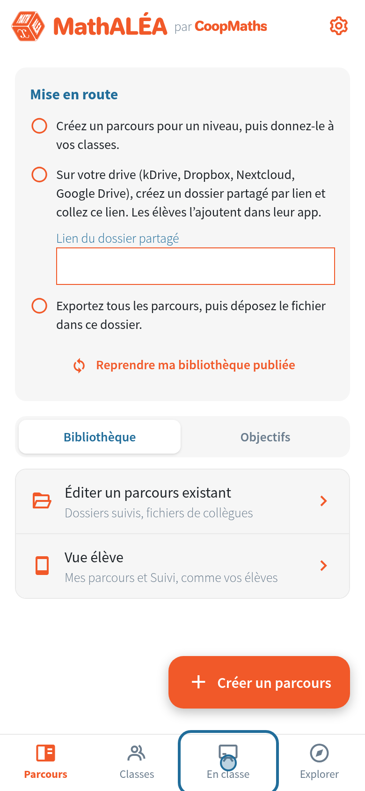

Chaque session lancée y est gardée, même si vous quittez l'écran : vous pouvez relever les réponses une heure après le cours. Chaque ligne indique le code, la date, le réglage et le nombre d'élèves. La croix supprime une session, après confirmation : pratique pour effacer les sessions d'essai ou restées sans réponse.

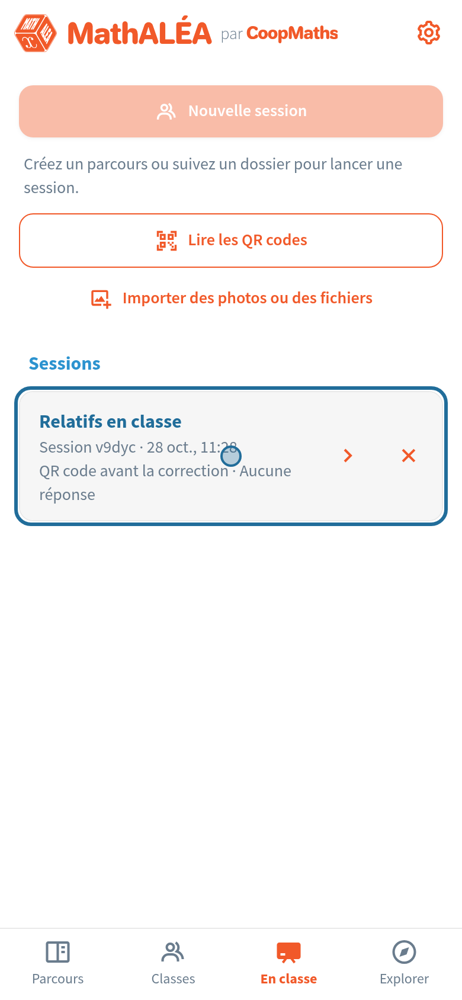

Touchez une session pour retrouver sa page : son QR code, son code et « Lire les QR codes ».

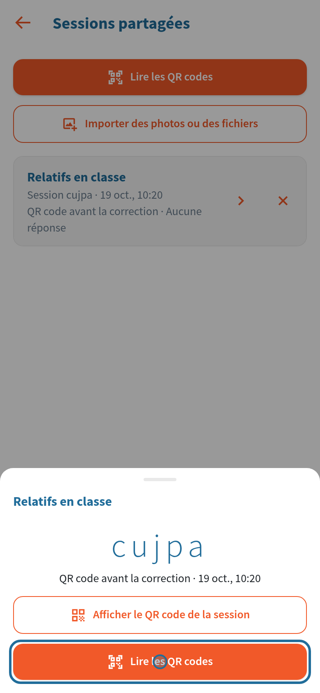

Touchez « Lire les QR codes », sur la page de la session ou dans l'onglet En classe (les réponses vont toujours dans leur session).

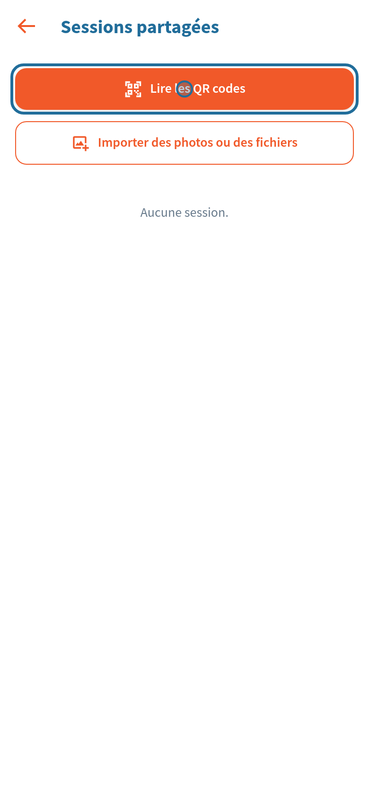

Passez dans les rangs : chaque code lu s'ajoute au compteur, et un même élève n'est compté qu'une fois. Touchez « Terminer » quand tout le monde est passé.

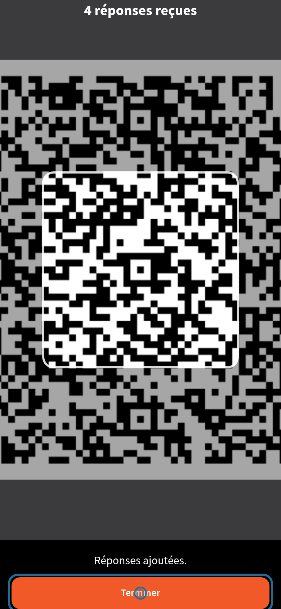

Autres façons de relever les réponses, avec « Importer des photos ou des fichiers » :

- une photo de plusieurs téléphones posés sur la table (quatre par photo, par exemple) ;
- les fichiers envoyés par les élèves.

La première fois, l'application demande l'accès à la caméra. Sans caméra (ordinateur sans webcam, accès refusé), l'import reste possible.

## 4. Les réponses de la classe

Touchez la session dans l'onglet En classe. Sa page montre en haut son code, son QR code et « Lire les QR codes » pour ajouter des réponses ; dessous, les réponses de la classe. L'application regénère les questions de la session et revérifie elle-même chaque réponse : un QR code modifié ne fausse rien.

En tête, le résumé : la réussite moyenne, le nombre d'élèves sous 50 %, entre 50 et 79 % et à 80 % et plus, et les questions à reprendre (moins de 70 % de réussite).

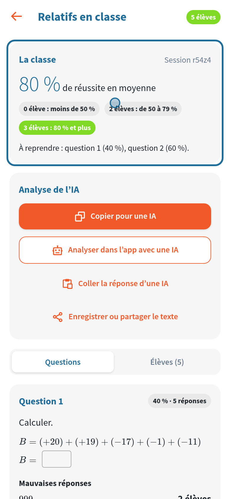

**Vue Questions.** Les questions arrivent des moins réussies aux plus réussies, avec le taux de réussite et les mauvaises réponses regroupées (« 999 : 2 élèves »). Sans prénom, c'est anonyme : vous pouvez le projeter pour en discuter avec la classe. « Voir la correction » rappelle la réponse attendue.

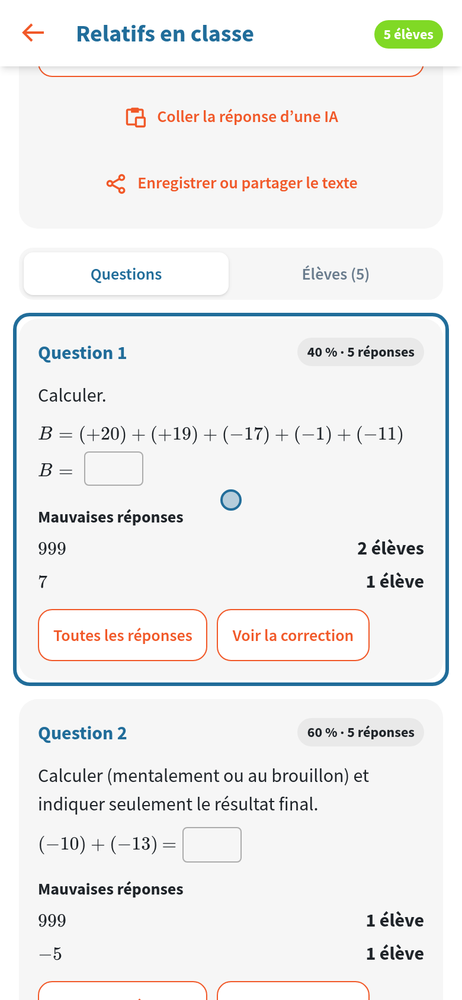

« Toutes les réponses » montre aussi les réponses correctes, et qui a donné quoi.

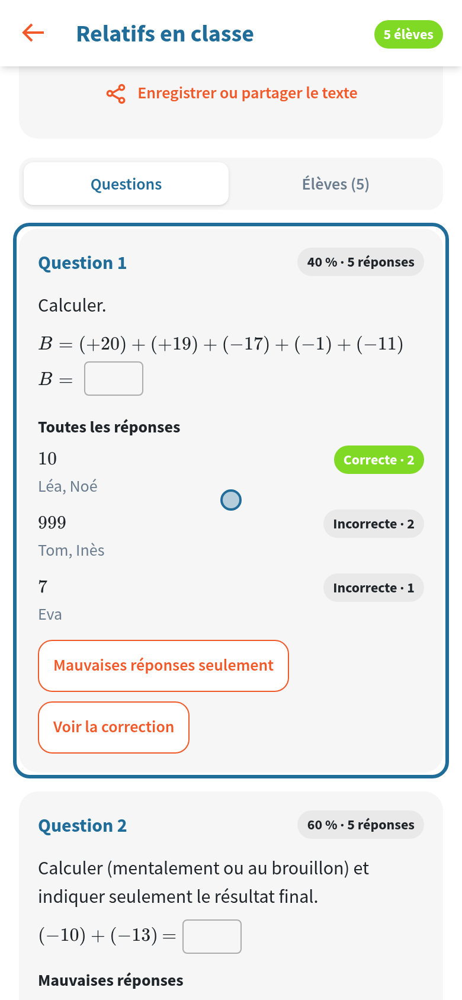

**Vue Élèves.** Les élèves, des plus en difficulté aux plus à l'aise, avec leur score. Touchez un élève pour voir toutes ses réponses, correctes et incorrectes.

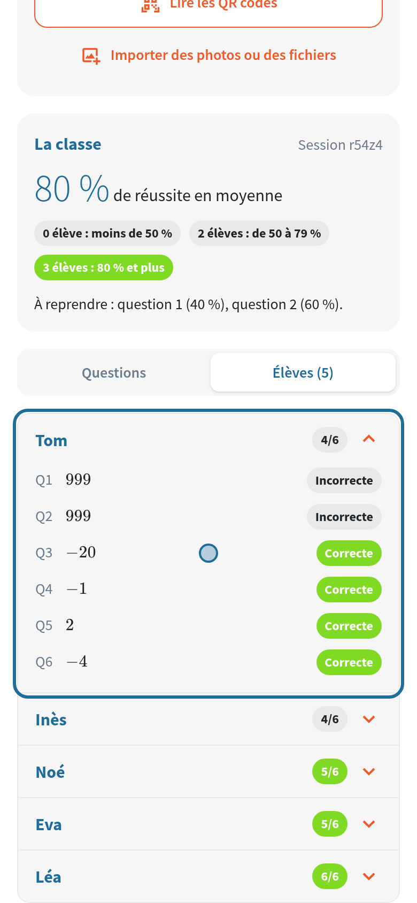

## 5. Une analyse des erreurs par une IA

L'IA ne voit jamais un prénom. Chaque élève y devient « Élève 1 », « Élève 2 »…, et la consigne lui demande de garder ces numéros dans sa réponse. L'application remet ensuite les prénoms, sur votre écran seulement. Si l'IA écrit autrement (« le troisième élève »), ce passage reste simplement anonyme.

**Sans réglage.** « Copier pour une IA » prépare un texte à coller dans l'assistant de votre choix : énoncés, corrections, taux de réussite, mauvaises réponses et réponses de chaque élève sous son numéro. Il demande quelles conceptions erronées expliquent les erreurs fréquentes, quelle courte activité proposer au prochain cours, et une piste pour chaque élève en difficulté. « Enregistrer ou partager le texte » l'envoie vers une autre application du téléphone.

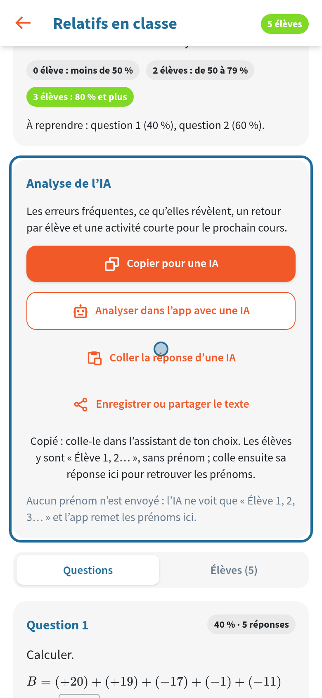

Collez ensuite la réponse de l'assistant avec « Coller la réponse d'une IA » : les numéros y redeviennent des prénoms.

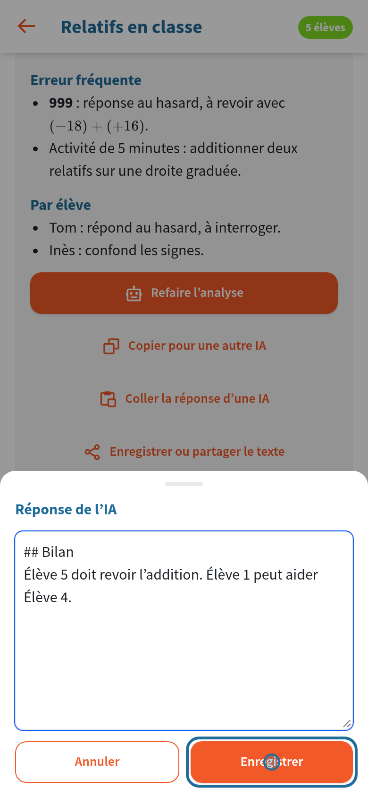

**Directement dans l'application.** « Analyser dans l'app avec une IA » ouvre les réglages de l'IA. Choisissez le service :

- **Claude (Anthropic)**, **Mistral** ou **OpenAI** : il suffit d'une clé d'API, à créer sur le site du service (le lien est dans les réglages). Chaque analyse est facturée sur le compte de la clé (quelques centimes).
- **IA locale** (Ollama, LM Studio…) : gratuite, et rien ne sort de votre réseau. L'adresse d'Ollama est proposée ; les modèles installés s'affichent, touchez-en un. Pour LM Studio, l'adresse est `http://localhost:1234/v1`.
- **Autre adresse compatible OpenAI** : un service qui suit le même format (celui de votre établissement, par exemple). Adresse, modèle et, si besoin, clé.

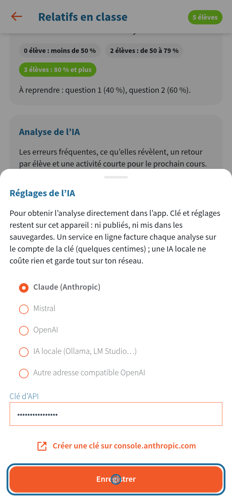

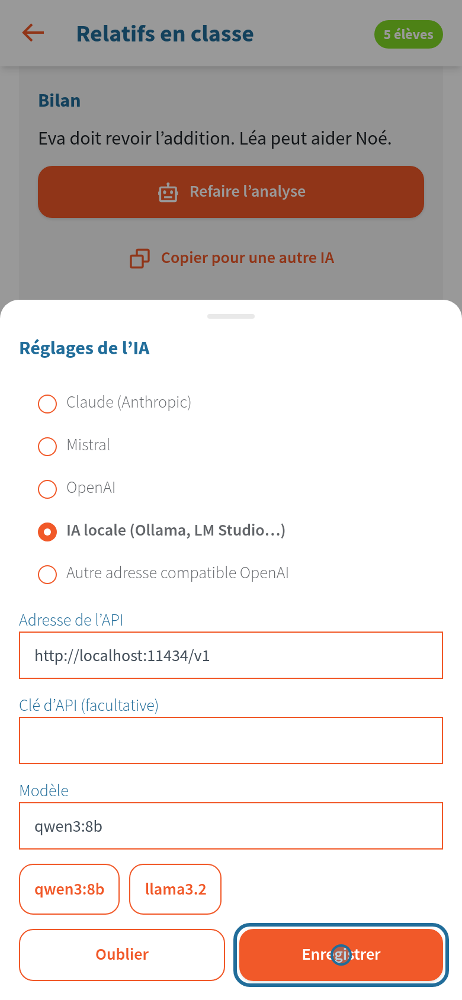

Clé et réglages restent sur votre appareil : ils ne sont ni publiés ni mis dans vos sauvegardes. Une adresse en `http://` n'est acceptée que sur le réseau local (votre ordinateur, l'école) ; sur internet, il faut `https://`.

L'analyse s'affiche au fur et à mesure, avec les prénoms. Elle reste enregistrée avec la session. « Refaire l'analyse » la relance, par exemple après avoir relevé de nouvelles réponses ; « Réglages de l'IA », en bas, change de service.

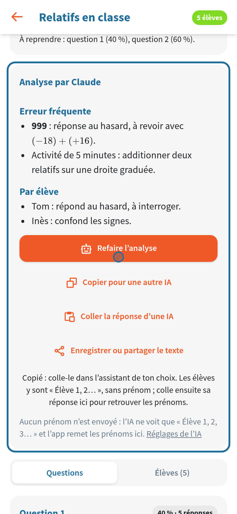

**IA locale depuis le téléphone.** `localhost` désigne l'appareil lui-même. Si l'IA tourne sur votre ordinateur et que vous analysez sur le téléphone, mettez l'adresse de l'ordinateur sur le réseau (par exemple `http://192.168.1.20:11434/v1`), et lancez Ollama pour qu'il accepte les autres appareils (`OLLAMA_HOST=0.0.0.0`). Un petit modèle peut couper un texte long : pour une grande classe, préférez un modèle récent à grande fenêtre de contexte.

## Bon à savoir

- Le QR code contient la première réponse vérifiée de chaque question, celle qui compte dans le score.
- Si l'application d'un élève n'a pas la même version des exercices que la vôtre, ses réponses aux questions concernées sont mises à part plutôt que mal corrigées.
- « Supprimer » (corbeille) efface les réponses d'une session de votre appareil.
